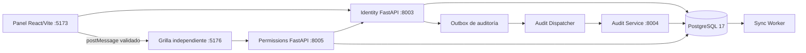

# I AM SECURE

## Plataforma de Gobierno y Gestión Centralizada de Identidades y Accesos

**AUTORES**

- Oscar Daniel Acosta
- David Enrique Diaz
- Ingrid Tatiana Vesga
- Jean Carlos Almenarez Ríos
- Yeison Fabián Bernal López

[](https://github.com/jeancarlosalmenarez8318-tech/DevSecOps-proyecto-Final/actions/workflows/devsecops-pipeline.yml?query=branch%3Amaster)
[](https://github.com/yeisonfblopez/DevSecOps-proyecto-Final-ci/actions/workflows/devsecops-pipeline.yml?query=branch%3Amaster)
[](docs/evidencias/2026-10-14/stride-hardening-lab/README.md)
[](docs/evidencias/2026-10-13/coverage-python/README.md)


[](https://github.com/jeancarlosalmenarez8318-tech/DevSecOps-proyecto-Final/actions/runs/37574847806)


> **Proyecto académico — Grupo 1 — DEVSECOPS2026_2**

---

## Tabla de Contenidos

1. [Descripción del Proyecto](#1-descripción-del-proyecto)
2. [Problema y Justificación](#2-problema-y-justificación)
3. [Objetivos](#3-objetivos)
4. [Alcance](#4-alcance)
5. [Arquitectura de la Solución](#5-arquitectura-de-la-solución)
6. [Tecnologías Empleadas](#6-tecnologías-empleadas)
7. [Estado Actual de Implementación](#7-estado-actual-de-implementación)
   - [Continuidad del equipo](#continuidad-del-equipo)
8. [Seguridad Implementada](#8-seguridad-implementada)
9. [Estructura del Repositorio](#9-estructura-del-repositorio)
10. [Inicio Rápido](#10-inicio-rápido)
    - [Entrega y clonación desde el repositorio del profesor](docs/entrega/ENTREGA_REPOSITORIO_CURSO.md)
    - [Manual paso a paso para Windows y Linux](docs/usuario/MANUAL_EJECUCION_WINDOWS_LINUX.md)
    - [Descargar manual de ejecución PDF](docs/usuario/MANUAL_EJECUCION_WINDOWS_LINUX.pdf)
11. [Documentación Técnica](#11-documentación-técnica)
12. [Pipeline DevSecOps](#12-pipeline-devsecops)
13. [Estado de Cumplimiento Académico](#13-estado-de-cumplimiento-académico)
14. [Licencia](#14-licencia)

---

## 1. Descripción del Proyecto

**IAM Secure** es una plataforma de gobierno y gestión centralizada de identidades y accesos orientada a administrar de manera segura, controlada y auditable el ciclo de vida de los usuarios, sus roles, compañías, credenciales, sesiones y accesos.

La solución se desarrolla como proyecto académico para la asignatura **Seg en Entornos Cloud y Devops** (grupo **DEVSECOPS2026_2**) y adopta una arquitectura basada en microservicios, contenerización y prácticas DevSecOps.

El proyecto integra progresivamente capacidades de:

- autenticación;
- autorización;
- control de acceso basado en roles (RBAC);
- aislamiento multitenant;
- administración de usuarios;
- administración de compañías;
- gestión segura de credenciales;
- MFA/TOTP;
- sesiones persistentes y revocables;
- procesamiento asíncrono mediante workers;
- trazabilidad y auditoría;
- automatización de pruebas;
- seguridad del ciclo de desarrollo;
- integración y despliegue continuo.

La aplicación constituye además el vehículo para implementar y demostrar un pipeline DevSecOps con controles de seguridad desde planificación hasta despliegue.

---

## 2. Problema y Justificación

La administración de identidades y permisos puede convertirse en un proceso complejo cuando la información de usuarios, roles, compañías, aplicaciones y privilegios se encuentra distribuida o depende de procesos manuales.

Esta situación puede generar:

- asignación inadecuada de privilegios;
- dificultad para aplicar mínimo privilegio;
- accesos horizontales entre organizaciones;
- sesiones que permanecen activas después de cambios sensibles;
- falta de trazabilidad sobre operaciones administrativas;
- inconsistencias en el ciclo de vida de los usuarios;
- debilidad en el control de credenciales;
- incremento del riesgo de acceso no autorizado.

IAM Secure busca centralizar estos procesos mediante servicios especializados, controles de seguridad en backend, procesamiento asíncrono y auditoría persistente.

---

## 3. Objetivos

### 3.1 Objetivo General

Diseñar e implementar una plataforma de gobierno y gestión de identidades y accesos que permita administrar de forma segura, eficiente y auditable el ciclo de vida de usuarios, permisos y accesos, utilizando una arquitectura de microservicios y prácticas DevSecOps.

### 3.2 Objetivos Específicos

- Centralizar la administración de identidades y accesos.
- Implementar autenticación segura con JWT y MFA.
- Implementar autorización RBAC.
- Aplicar aislamiento multitenant por compañía.
- Gestionar usuarios, compañías, credenciales, roles y sesiones.
- Proteger contraseñas mediante Argon2.
- Revocar sesiones ante cambios sensibles.
- Incorporar procesamiento asíncrono mediante workers.
- Implementar trazabilidad y auditoría persistente.
- Contenerizar los componentes de la solución.
- Implementar pruebas automatizadas.
- Incorporar SAST, SCA, DAST, escaneo de secretos e imágenes.
- Implementar un pipeline CI/CD con seguridad integrada.
- Incorporar modelado de amenazas con Threat Dragon y STRIDE.
- Mantener documentación técnica versionada con el código y un informe PDF con evidencias, hallazgos y límites.

---

## 4. Alcance

IAM Secure se encuentra actualmente **en desarrollo incremental**.

### 4.1 Funcionalidades implementadas y validadas

Actualmente se encuentran implementadas o integradas:

- PostgreSQL 17 como base de datos.
- Identity Service en FastAPI.
- Frontend SPA en React/Vite.
- JWT con identificador de sesión `jti`.
- Hash de contraseñas con Argon2.
- contraseña temporal y cambio obligatorio;
- expiración de contraseña;
- recuperación de contraseña por correo;
- MFA/TOTP;
- sesiones persistentes y revocables;
- RBAC;
- administración de usuarios;
- administración de compañías;
- asignación de compañías;
- aislamiento multitenant;
- Sync Worker asíncrono;
- Audit Service;
- Audit Dispatcher;
- Outbox persistente de auditoría;
- auditoría append-only;
- informe de auditoría XLSX para ADMIN TI, con identificación del usuario que ejecutó el evento, aceptado localmente;
- Docker Compose para el entorno local;
- API Permissions y grilla independiente de ADMIN_SOPORTE, integradas en `master`;
- pruebas Pytest, integración con PostgreSQL y comprobaciones de navegador en CI.

La carga masiva Excel está integrada en `master` mediante el PR #3 y validada funcionalmente en el PC: creación, rechazo de duplicados y exportación funcionan correctamente. El ajuste de inactividad está probado y funciona correctamente en grilla y carga masiva; se publicó en el commit `624ab1d` y su prueba se incorporó al CI, aprobado. Consultar el [estado por versión](#7-estado-actual-de-implementación).

### 4.2 Roles actuales

Los roles principales de la plataforma son:

```text
ADMIN_TI
ADMIN_SOPORTE
LIDER_FACTURACION
LIDER_LOGISTICA
LIDER_GESTION_HUMANA
```

El modelo administrativo actual separa las responsabilidades de administración TI, soporte y líderes funcionales, complementando RBAC con controles por compañía.

### 4.3 Componentes pendientes del alcance académico

- El PR #3 completó su revisión final y fue integrado en `master`; carga Excel, inactividad, frontend optimizado, auditoría XLSX, seguridad T13/T15, DAST activo controlado, Threat Modeling actualizado y evidencia de instalación limpia forman parte del código vigente.
- Completar, si se dispone de los correos funcionales necesarios, el lote de varias filas con usuarios de Facturación y Logística; esta prueba no bloquea la evidencia ya obtenida de creación individual, SMTP real ni carga Excel validada.
- Mantener el Quality Gate aprobado y ampliar cobertura global: 61a1f7a aprobó CI 32/32, nueva 85,6 % ≥ 80 % y global 56,7 %. [E32: cobertura y Sonar](docs/evidencias/2026-10-14/stride-hardening-lab/README.md). E25/E27 conservan los resultados históricos.
- Conservar [E26: ZAP automatizado](docs/evidencias/2026-10-13/zap-staging-ci/README.md): staging GET-only automatizado en CI, gate MEDIUM/HIGH y limpieza aprobados. Ampliar login/MFA, XLSX, mutaciones y frontend solo como alcances adicionales; no atribuirlos al escaneo actual.
- Publicar, si se aprueba como parte del cierre, una nueva versión de imágenes Docker que incluya los cambios posteriores a `1.0.0`, y repetir su validación de despliegue con esa versión.
- Ampliar cobertura global Sonar (56,7 %) y componentes React no medidos; E22 conserva su 69 % local histórico de cinco servicios Python.
- Completar las capturas finales de las funciones administrativas que se quieran incluir en la entrega y consolidar la demostración funcional.
- Resolver la visibilidad pública requerida del repositorio antes de la entrega.
- Informe técnico ya generado y revisado: [Informe técnico PDF](docs/informe/INFORME_TECNICO_IAM_SECURE_2026-10-14_STRIDE_LAB.pdf). Preparar y grabar el video de sustentación de 10–15 minutos.
- Revisar/adoptar los controles de laboratorio para T03, T04, T06, T07, T10 y T14 y registrar la decisión residual posterior; su riesgo continúa no aceptado. La decisión humana de riesgo residual de T01–T20 ya está documentada para el alcance académico/local.

Ya no se consideran pendientes la actualización/revisión/exportación del Threat Model/DFD ni la instalación desde cero en un segundo computador: ambos fueron completados y cuentan con evidencia versionada del 13 de octubre. Gitleaks, Semgrep, Bandit, SCA, Docker/Trivy, Pytest, DAST pasivo, DAST activo controlado, Threat Dragon/STRIDE, MFA/RBAC y la instalación limpia reproducible cuentan con evidencia dentro del alcance documentado. Los pendientes anteriores corresponden al cierre del ciclo y de la entrega académica.


---

## 5. Arquitectura de la Solución

### 5.1 Diseño vigente

IAM Secure adopta un enfoque de microservicios y componentes especializados para separar presentación, identidad, procesamiento asíncrono, auditoría, persistencia y automatización DevSecOps.

La descripción detallada, decisiones de diseño y diagramas se mantienen en el [Manual de Arquitectura](docs/arquitectura/ARQUITECTURA.md).

### 5.2 Arquitectura implementada actualmente



El panel transmite la sesión a la ventana/origen autorizados de grilla; esta la conserva en memoria. Permissions verifica la sesión mediante Identity y aplica controles por usuario y compañía. Las tarjetas de líderes siguen siendo vistas académicas de referencia.

La carga Excel integrada en `master` agrega validación, vista previa, confirmación y resultados persistidos en `cargas_usuarios` y `cargas_usuario_filas`, utilizando Identity. Ese flujo está integrado en `master` mediante el PR #3. Los cuatro UML ya representan el nuevo alcance; los DFD de Threat Dragon fueron actualizados, revisados visualmente y exportados el 13 de octubre.

### 5.3 Servicios de Docker Compose

| Servicio | Contenedor | Propósito | Exposición |
|---|---|---|---|
| `postgres` | `iam-secure-postgres` | Persistencia | 5433 → 5432 |
| `identity` | `iam-secure-identity` | Identidad y autenticación | 8003 |
| `frontend` | `iam-secure-frontend` | Panel SPA | 5173 |
| `permissions` | `iam-secure-permissions` | Permisos por usuario/compañía | 127.0.0.1:8005 |
| `permissions-grid` | `iam-secure-permissions-grid` | Grilla independiente | 127.0.0.1:5176 |
| `sync-worker` | `iam-secure-sync-worker` | Procesamiento asíncrono | Sin puerto |
| `audit-service` | `iam-secure-audit` | Persistencia de auditoría | 127.0.0.1:8004 |
| `audit-dispatcher` | `iam-secure-audit-dispatcher` | Entrega asíncrona de auditoría | Sin puerto |
| `identity-bootstrap` | perfil `bootstrap` | Aprovisionamiento inicial | Ejecución puntual |

La tabla describe desarrollo local; el CD simulado usa Compose separado por digest. PostgreSQL es compartido, D1–D6 son particiones lógicas y Sync mantiene un conector simulado. Bootstrap es puntual; `usuarios` tiene Dockerfile histórico, pero no está activo en este Compose.

---

## 6. Tecnologías Empleadas

| Tecnología | Uso dentro del proyecto | Estado |
|---|---|---|
| Python 3.14 | Servicios backend y workers | Implementado |
| FastAPI | Identity, Audit y Permissions | Implementado |
| Uvicorn | Servidor ASGI | Implementado |
| PostgreSQL 17 | Persistencia relacional | Implementado |
| SQLAlchemy | Acceso a PostgreSQL | Implementado |
| JWT | Autenticación | Implementado |
| Argon2 | Hash de contraseñas | Implementado |
| TOTP | MFA | Implementado |
| React | Frontend SPA | Implementado / integrado |
| Vite | Build y desarrollo frontend | Implementado |
| Docker | Contenerización | Implementado |
| Docker Compose | Entorno local | Implementado |
| Git / GitHub | Versionamiento y repositorio | Implementado |
| Markdown | Documentación como código | Implementado |
| Mermaid / PlantUML | Cuatro UML actualizados como código | Implementado; DFD se evalúa en Threat Dragon |
| OWASP Threat Dragon | DFD nivel 0 y 1 del alcance actual | Implementado, revisado visualmente y exportado; evidencia versionada del 13 de octubre |
| STRIDE | 20 amenazas documentadas en seis categorías | Modelo actualizado: 18 amenazas Open y T13/T15 Mitigated; decisión de riesgo residual documentada para alcance académico/local. T03, T04, T06, T07, T10 y T14 conservan riesgo no aceptado y adopción/revisión residual pendientes. |
| Gitleaks | Hook pre-commit y escaneo de historial en CI | Implementado y probado |
| Semgrep / Bandit | SAST | Implementado; validación local vigente sin hallazgos de severidad/confianza MEDIUM o superior en Bandit y sin hallazgos Semgrep en el alcance ejecutado |
| pip-audit / npm audit / Snyk | SCA de dependencias | Implementado; runtime vigente validado localmente y riesgos residuales de tooling documentados por separado |
| Trivy de dependencias | SCA de manifiestos, locks y dependencias resueltas | Job aprobado en 61a1f7a; E24 conserva el conteo histórico 10/10 y dos MEDIUM de tooling, no un inventario actual en cero. |
| Trivy | Escaneo de imágenes Docker y gate CRITICAL | Implementado; publicación 1.0.0 cuenta con evidencia histórica aprobada, pero las imágenes actuales aún no han sido republicadas |
| OWASP ZAP | DAST pasivo y activo controlado automatizado | Staging GET-only aprobado en CI: 7 scans, 39 API/rol, 1947 requests; gate MEDIUM/HIGH, reportes HTML/JSON y limpieza, E26. No cubre toda la aplicación. |
| SonarQube Cloud | Análisis, importación XML/LCOV y Quality Gate exigido por CI | 61a1f7a: Quality Gate passed, nueva 85,6 % ≥ 80 %, global 56,7 %. E32. |
| Ansible | IaC y despliegue aislado | Implementado y probado en etapa 2: segunda ejecución changed=0 |
| Checkov | Escaneo IaC Ansible | 2 controles aprobados y prueba negativa de bloqueo; Compose usa validador propio |
| GitHub Actions | CI/CD y ejecución en el espejo | [61a1f7a, CI 32/32](https://github.com/yeisonfblopez/DevSecOps-proyecto-Final-ci/actions/runs/38638956405) y Quality Gate Sonar aprobado, nueva 85,6 %. CD E24 conserva 30/30 sobre imágenes 1.0.0 históricas. |
| Prometheus / Grafana | Observabilidad opcional | Pendiente / bonificación |
| Loki / ELK | Centralización de logs opcional | Pendiente / bonificación |
| Falco | Detección runtime opcional | Pendiente / bonificación |

---

## 7. Estado Actual de Implementación

**Entrega en el repositorio del profesor:** rama [`I-AM-SECURE`](https://github.com/jaiderospina/DEVSECOPS2026_2/tree/I-AM-SECURE), Grupo 1. Código de origen `0dd6fdd7589b827ebc18960a37e277354ddb7a13`; [procedencia y ejecución de esta rama](docs/entrega/ENTREGA_REPOSITORIO_CURSO.md). Las evidencias siguientes conservan los commits y resultados de los repositorios de desarrollo.

**Actualizado: 17 de octubre de 2026 (America/Bogota).** Revisión documental de los catorce apartados del índice contra código, evidencia y entregables; E35 añade el manual Windows/Linux y la confirmación humana de otro PC. El avance funcional está integrado en `master` de ambos repositorios; carga Excel, grilla, inactividad e informe de auditoría XLSX forman parte de esa base. El PR #3 fue integrado mediante `19b54ee`.

- **✅ Cumplido:** requisito implementado y con evidencia para el alcance indicado.
- **🟡 Parcial:** existe avance concreto, pero queda al menos un cierre independiente.
- **⏳ Pendiente:** no existe todavía evidencia suficiente para considerarlo completado.

### Resumen de avances y cierre pendiente

| Área | Estado | Completado / evidencia | Pendiente para cerrar |
|---|---|---|---|
| Aplicación local | ✅ Cumplido en alcance funcional | Identidad, MFA, RBAC, compañías, Excel, grilla, inactividad e informe XLSX integrados en master y aceptados localmente. Instalación independiente E21. | Sin nueva release Docker; no se inventa un E2E adicional. |
| Informe de auditoría | ✅ Cumplido funcionalmente; release pendiente | XLSX con hojas Auditoria/Resumen, filtros y datos del actor; permisos ADMIN_TI/MFA y límites probados. | Incorporarlo en una nueva publicación de imágenes si se decide generar release final. |
| Carga masiva ampliada | 🟡 Parcial | Validación, consentimiento, creación, duplicados, persistencia y exportación probados. La regresión Excel vigente aprobó 86 casos dentro de su suite. | Prueba opcional de lote con varias filas y correos funcionales de Facturación/Logística cuando se disponga de esas cuentas. |
| SCA y dependencias | 🟡 Parcial de cierre | Jobs SCA aprobados en 61a1f7a (E32). E24 conserva 10 manifiestos y dos MEDIUM; riesgos asteval/ply de tooling documentados. | Revisar/decidir tratamiento residual de tooling; no declarar SCA global con cero vulnerabilidades. |
| SonarCloud | ✅ Quality Gate aprobado | 61a1f7a: nueva 85,6 % ≥ 80 %, global 56,7 %; todas las condiciones aprobadas. [E32](docs/evidencias/2026-10-14/stride-hardening-lab/README.md). | Ampliar cobertura global y priorizar los 42 issues nuevos informados por el check de E32; preservar umbrales y validar cada revisión. |
| GitHub Actions | ✅ CI y Sonar aprobados en el espejo | [CI 32/32 de 61a1f7a](https://github.com/yeisonfblopez/DevSecOps-proyecto-Final-ci/actions/runs/38638956405); ZAP, Sonar y gate incluidos. E32. | Validar los checks de cada revisión posterior y preservar el gate. |
| Ansible, Checkov y CD | ✅ Producción simulada aprobada en el espejo | [30/30 trabajos](https://github.com/yeisonfblopez/DevSecOps-proyecto-Final-ci/actions/runs/38502831730); segunda ejecución changed=0, persistencia y controles runtime. | Usa imágenes históricas `1.0.0`; validar una nueva release por separado. |
| Docker Hub y versión | ✅ Cumplido para `1.0.0`; actualización pendiente | Imágenes `1.0.0`/`latest` publicadas y verificadas mediante push/pull y digests. | Publicar una versión nueva si se quiere que Docker Hub represente el código actual posterior a `1.0.0`. |
| Threat Dragon, DFD y STRIDE | ✅ Modelo actualizado; decisión residual documentada | DFD nivel 0 y 1 actualizados, revisados visualmente y exportados; modelo con T01–T20 y paridad STRIDE validada. T13/T15 están Mitigated y la aceptación humana para alcance académico/local quedó registrada. | Tratar T03, T04, T06, T07, T10 y T14, cuyo riesgo residual no fue aceptado. |
| ZAP y staging | ✅ Automatización cumplida en alcance definido | [E26: ZAP automatizado](docs/evidencias/2026-10-13/zap-staging-ci/README.md): CI real, staging nuevo, 7 scans/39 API-rol, reportes y limpieza. | Login/MFA, XLSX, mutaciones y frontend requieren ampliación separada. |
| Documentación y capturas | 🟡 Documentación sincronizada; capturas finales pendientes | README reorganizado al 17 de octubre, manual Windows/Linux E35, matriz y checkpoint actual; UML/DFD e informe técnico conservan sus cortes verificados. | Completar las capturas administrativas y la presentación de sustentación. |
| Badges y cobertura | 🟡 Parcial global | Build, release histórica Docker Hub y badge Sonar nueva 85,6 % aprobado enlazan evidencia. Python CI 79,01 % de líneas; LCOV de cinco módulos. | Sonar global 56,7 %; ampliar React y otros componentes. E22 conserva 69 % local histórico. |
| Instalación reproducible | ✅ Cumplido | Instalación desde cero validada en un iMac Intel independiente: secretos nuevos, build 7/7, servicios, migraciones, `ADMIN_TI`, cambio obligatorio de contraseña, MFA, SMTP real, creación de `ADMIN_SOPORTE`, Permissions Grid y persistencia tras recrear contenedores. | No se exige repetirla salvo que cambie de forma material el procedimiento o el release utilizado. |
| Integración del PR #3 | ✅ Cumplido | PR #3 revisado e integrado en `master` mediante el merge commit `19b54ee`. | Mantener la documentación posterior al merge alineada con el estado vigente. |
| Entrega académica | 🟡 Parcial | [Informe técnico PDF](docs/informe/INFORME_TECNICO_IAM_SECURE_2026-10-14_STRIDE_LAB.pdf): 23 páginas, índice, autores, diagramas y hallazgos. | Acceso público, video/capturas, cobertura global/React y seis riesgos residuales no aceptados. |
| Observabilidad opcional | ⏳ Pendiente opcional | No se acredita implementación. | Prometheus/Grafana, Loki/ELK y Falco son bonificaciones y no bloquean los requisitos obligatorios. |

Las cifras de pruebas corresponden a suites y alcances distintos y **no deben sumarse como si fueran casos independientes ni interpretarse como porcentaje de cobertura**. La evidencia local, el despliegue histórico aprobado y la instalación limpia tampoco sustituyen un CI integral del commit vigente. Del mismo modo, cero alertas en el DAST activo controlado solo aplica al alcance GET-only ejecutado y no demuestra ausencia total de vulnerabilidades.


### Propósito y justificación

| Requisito | Estado y avance |
|---|---|
| Propósito y justificación del proyecto | ✅ **Cumplido.** Descripción, problema, justificación y objetivos incluidos en este README. |

### 3.1 Arquitectura de la aplicación

| Requisito | Estado y avance |
|---|---|
| Arquitectura de microservicios | ✅ **Cumplido.** Identity, Permissions, Audit y workers separados. [Arquitectura](#5-arquitectura-de-la-solución). |
| Frontend SPA con React o Vue | ✅ **Cumplido.** React/Vite con panel y entrada independiente de grilla. |
| Backend/API Gateway con FastAPI, Flask o Node.js | ✅ **Cumplido.** Backend FastAPI en los servicios propios. |
| Al menos un worker asíncrono independiente | ✅ **Cumplido.** Sync Worker y Audit Dispatcher implementados y probados. [Sync](docs/SYNC_WORKER_VALIDACION.md) y [Audit](docs/AUDIT_VALIDACION.md). |
| Base de datos de código abierto | ✅ **Cumplido.** PostgreSQL 17. |
| JWT u OAuth2 con control básico de roles | ✅ **Cumplido.** JWT, sesiones revocables y RBAC; MFA amplía el requisito. [Seguridad](#8-seguridad-implementada). |

### 3.2 Contenerización

| Requisito | Estado y avance |
|---|---|
| Dockerfile por servicio, base mínima, usuario no root y capas optimizadas | ✅ **Cumplido en la rama de etapa 2.** Dockerfiles slim/alpine, caché de dependencias y frontend multietapa con Nginx mínimo. CI aprobó UID no root para las siete imágenes y arranque HTTP del frontend. Imagen frontend reducida un 94,83 %; [evidencia](docs/evidencias/2026-10-06/CONTENEDORES_CI_9b6affc.json). Integrado en `master` mediante el PR #3. |
| docker-compose.yml para desarrollo local | ✅ **Cumplido.** Servicios contenerizados y entorno local operativo. |
| Imágenes publicadas en Docker Hub bajo cuenta del equipo | ✅ **Cumplido.** Siete imágenes propias publicadas en jeancarlosalmenarez8318; autenticación, push y descarga verificados. [Run: 29/29 trabajos aprobados](https://github.com/jeancarlosalmenarez8318-tech/DevSecOps-proyecto-Final/actions/runs/37574847806) · [Digests duraderos](docs/evidencias/2026-10-07/DOCKERHUB_1.0.0_37574847806.json) · [Guía](docs/despliegue/IMAGENES_Y_DOCKERHUB.md). |
| Etiquetas semánticas y latest | ✅ **Cumplido.** Las siete imágenes tienen 1.0.0 y latest; las 14 descargas se verificaron y ambas etiquetas coinciden en digest por imagen. Metadatos del commit ab44403 y protección de versiones existentes. [Evidencia](docs/evidencias/2026-10-07/DOCKERHUB_1.0.0_37574847806.json). |

**Contenedores:** [CI `9b6affc`](https://github.com/jeancarlosalmenarez8318-tech/DevSecOps-proyecto-Final/actions/runs/37572601777), **27/27 trabajos aprobados**; siete UID no root, 147 Pytest, 11 comprobaciones de navegador Nginx y seis pruebas Node. Tamaño linux/amd64 sin comprimir: **252,81 MB → 13,07 MB (−94,83 %)**. [Registro duradero](docs/evidencias/2026-10-06/CONTENEDORES_CI_9b6affc.json). La publicación Docker Hub 1.0.0 terminó en el [run 37574847806](https://github.com/jeancarlosalmenarez8318-tech/DevSecOps-proyecto-Final/actions/runs/37574847806), **29/29 trabajos aprobados**: siete imágenes y 14 etiquetas verificadas por push/pull, con el mismo digest por imagen. [Registro duradero](docs/evidencias/2026-10-07/DOCKERHUB_1.0.0_37574847806.json); [artifact completo](https://github.com/jeancarlosalmenarez8318-tech/DevSecOps-proyecto-Final/actions/runs/37574847806/artifacts/11461914923), con expiración el 6 de noviembre de 2026. El despliegue histórico desde imágenes 1.0.0 está aprobado en el run 37578596462. El PR #3 ya fue integrado en `master`; sigue pendiente publicar/desplegar nuevas imágenes que representen el código vigente posterior a `1.0.0` si se decide emitir una nueva release.

### 3.3 Repositorio GitHub

| Requisito | Estado y avance |
|---|---|
| Código fuente completo en GitHub | ✅ **Cumplido.** El código vigente está integrado y publicado en `master` mediante el PR #3. |
| LICENSE | ✅ **Cumplido.** Licencia MIT versionada. |
| README.md | ✅ **Cumplido.** Descripción, tecnologías, inicio rápido y estado con evidencias disponibles. Los badges se evalúan en 4.1. |
| docker-compose.yml | ✅ **Cumplido.** Archivo versionado y operativo para desarrollo. |
| .github/workflows con pipelines CI/CD | ✅ Integrados: [61a1f7a, CI 32/32](https://github.com/yeisonfblopez/DevSecOps-proyecto-Final-ci/actions/runs/38638956405), con ZAP, cobertura importada y Quality Gate aprobado/requerido en CI directo del espejo. [E32](docs/evidencias/2026-10-14/stride-hardening-lab/README.md). CD E24 conserva su revisión con imágenes 1.0.0. |
| infraestructura con Terraform o Ansible | ✅ **Cumplido en etapa 2.** Ansible desplegó imágenes por digest y una segunda ejecución registró changed=0/failed=0. [Playbook](https://github.com/jeancarlosalmenarez8318-tech/DevSecOps-proyecto-Final/blob/ed00530990a494a616fe39770de65c2529915b96/infraestructura/ansible/deploy.yml). Instalación opcional de Docker no ejecutada en el runner. |
| orquestacion para despliegue | ✅ **Cumplido en etapa 2.** Compose diferenciado de producción simulada: ocho contenedores no root y persistencia comprobada al recrear PostgreSQL. [Manifiesto](https://github.com/jeancarlosalmenarez8318-tech/DevSecOps-proyecto-Final/blob/ed00530990a494a616fe39770de65c2529915b96/orquestacion/compose.simulated.json). |
| servicios con código por microservicio | ✅ **Cumplido.** Código organizado por servicio. |
| docs con documentación completa | ✅ Documentación principal revisada y sincronizada al 14 de octubre: manuales, UML/DFD, matriz, checkpoint e [Informe técnico PDF](docs/informe/INFORME_TECNICO_IAM_SECURE_2026-10-14_STRIDE_LAB.pdf). Las capturas finales mantienen su requisito parcial. |

### 3.4 Pipeline DevSecOps

| Requisito | Estado y avance |
|---|---|
| Fase 1: modelado con OWASP Threat Dragon | ✅ **Cumplido en modelado.** Modelo actualizado al alcance vigente, revisado visualmente y con exportaciones versionadas. [Modelo](docs/diagramas/threat-model/README.md). Estado vigente: 18 amenazas Open y T13/T15 Mitigated; decisión residual académica/local documentada. |
| Fase 1: DFD nivel 0 y nivel 1 | ✅ **Cumplido.** Ambos DFD fueron actualizados al alcance actual, revisados visualmente y exportados como evidencia el 13 de octubre. |
| Fase 1: identificación de amenazas STRIDE | ✅ **Cumplido en identificación/modelado.** T01–T20 documentadas en seis categorías y con paridad entre modelo y matriz. T13/T15 tienen controles probados y estado Mitigated; la decisión de riesgo residual quedó documentada para el alcance académico/local. [STRIDE](docs/seguridad/stride-matrix.md). |
| Fase 2: pre-commit con Gitleaks o TruffleHog | ✅ **Cumplido.** Gitleaks configurado y con prueba local registrada; también ejecutado en CI. Instalar el hook en cada clon. |
| Fase 2: SAST con Semgrep y Bandit | ✅ **Cumplido en implementación.** Ambos están integrados; la validación local vigente no produjo hallazgos Semgrep ni hallazgos Bandit de severidad/confianza MEDIUM o superior en el alcance ejecutado. Las aprobaciones de CI permanecen como evidencia histórica. |
| Fase 2: SCA con Dependency-Check o Trivy sobre dependencias | 🟡 Jobs vigentes aprobados en 61a1f7a (E32); E24 conserva 10 manifiestos/dos MEDIUM de tooling. Tratamiento residual de tooling pendiente. Sonar es un check distinto, aprobado en E32 con nueva 85,6 %. |
| Fase 3: construcción automática de imágenes Docker | ✅ **Cumplido.** Siete imágenes propias del pipeline estándar; el laboratorio construye además el gateway TLS. |
| Fase 3: escaneo de imágenes con Trivy o Grype | ✅ **Cumplido.** Trivy integrado sobre las siete imágenes y escaneo CRITICAL adicional del gateway en stride-lab. |
| Fase 3: fallo automático ante CVE crítica sin excepción justificada | ✅ **Cumplido.** Gate CRITICAL con código de fallo, incluidas CVEs sin corrección; gate final exige éxito de los controles. |
| Fase 4: pruebas unitarias con Pytest o Jest | ✅ **Cumplido.** Pytest integrado y suites aprobadas; etapa 2 registra 147 Pytest, 11 comprobaciones Chromium contra contenedores Nginx y seis pruebas Node de configuración en el run `37572601777` del commit `9b6affc`. |
| Fase 4: OWASP ZAP automatizado contra staging | ✅ **Cumplido en el staging GET-only.** [E26: ZAP automatizado](docs/evidencias/2026-10-13/zap-staging-ci/README.md): job requerido por el gate del espejo, alertas MEDIUM/HIGH bloqueantes, reportes y limpieza. No equivale a cobertura activa completa de la aplicación. |
| Fase 5: despliegue automatizado con Terraform o Ansible | ✅ **Cumplido con Ansible en producción simulada.** Despliegue real en runner Linux aislado, después de CI/IaC. [Run 37578596462](https://github.com/jeancarlosalmenarez8318-tech/DevSecOps-proyecto-Final/actions/runs/37578596462). |
| Fase 5: Checkov o tfsec | ✅ **Cumplido con Checkov.** CKV_ANSIBLE_5/6 aprobados; fixture insegura rechazada sin ejecutarse. [Evidencia](docs/evidencias/2026-10-07/ANSIBLE_CD_37578596462.json). |
| Fase 5: K3s, Swarm o Compose de producción simulada | ✅ **Cumplido con Compose.** Despliegue Ansible de imágenes 1.0.0 por digest; PostgreSQL sin puerto host, controles runtime y persistencia acreditados. |

### 3.5 Restricción de herramientas

| Requisito | Estado y avance |
|---|---|
| Herramientas de código abierto o libre uso; GitHub Actions/GitLab CI admitidos | ✅ **Cumplido en la selección actual.** Tecnologías abiertas o de libre uso y GitHub Actions operativo. El cierre de fases se evalúa arriba. |

### 4. Documentación obligatoria

| Requisito | Estado y avance |
|---|---|
| Documentación en español o inglés, Markdown y dentro del repositorio | ✅ **Cumplido en formato y ubicación.** Documentos en español bajo docs; completitud según las filas siguientes. |
| 4.1 README: descripción y propósito | ✅ **Cumplido.** Incluidos en este README. |
| 4.1 README: tecnologías | ✅ **Cumplido.** Tabla actualizada con herramientas y estados. |
| 4.1 README: licencia seleccionada | ✅ **Cumplido.** MIT identificada y enlazada. |
| 4.1 README: badges de build, cobertura y versión | 🟡 **Parcial.** Build alineado con master y badge de imágenes Docker Hub 1.0.0 con evidencia; badge Sonar nueva 85,6 % aprobado y evidencia E32; global 56,7 % parcial. E22 conserva 69 % local histórico. Alcance integral y actualización automática pendientes. |
| 4.1 README: inicio rápido | ✅ **Cumplido y validado.** Clonación, configuración, Compose, aprovisionamiento y accesos documentados; el procedimiento fue reproducido desde cero en un segundo computador. |
| 4.2 Manual de arquitectura: componentes, decisiones, patrones y justificación | ✅ **Cumplido como documentación.** Manual actualizado con Identity, Permissions, grilla, Excel, outbox, sesiones, Nginx y decisiones/límites verificados por código. |
| 4.2 UML: componentes | ✅ **Cumplido.** Diagrama actualizado con Permissions, grilla, carga Excel, SMTP y workers; distingue servicios activos e históricos. |
| 4.2 UML: despliegue | ✅ **Cumplido para desarrollo.** Representa los servicios actuales, puertos reales, red, volumen y migraciones; distingue Docker Hub de Compose local. |
| 4.2 UML: secuencia de un flujo crítico | ✅ **Cumplido.** Autenticación/MFA/contraseña temporal más transferencia de sesión a la grilla y vencimiento por cinco minutos. |
| 4.2 UML: casos de uso | ✅ **Cumplido.** Actores/alcance, carga Excel y excepciones de vistas actualizados en Mermaid y PlantUML. |
| 4.2 DFD 0/1 con Threat Dragon | ✅ **Cumplido.** DFD nivel 0 y 1 actualizados, revisados visualmente y exportados; evidencia versionada del 13 de octubre. |
| 4.3 Desarrollo: clonar y configurar entorno | ✅ **Cumplido y validado.** Manual consolidado con configuración, ramas, volúmenes y aprovisionamiento; el procedimiento fue probado mediante clon limpio en un iMac Intel independiente. |
| 4.3 Desarrollo: ejecutar servicios | ✅ **Cumplido como documentación.** Servicios, puertos, reconstrucción y comprobaciones de Compose actualizados. |
| 4.3 Desarrollo: ejecutar pruebas unitarias/integración | ✅ **Cumplido como documentación.** Suites, comandos, dependencias, aislamiento de PostgreSQL y pruebas de navegador explicados con resultados de CI verificables. |
| 4.3 Desarrollo: ramas, commits y revisión | ✅ **Cumplido como documentación.** Estrategia, Conventional Commits y revisión definidos. |
| 4.4 Despliegue: requisitos de máquina destino | ✅ **Cumplido para el entorno validado.** Requisitos documentados y utilizados satisfactoriamente durante la instalación limpia en un segundo computador Intel. |
| 4.4 Despliegue: variables y gestión segura | ✅ **Cumplido como documentación.** Variables, marcadores y gestión de secretos descritos; secretos reales excluidos de Git. |
| 4.4 Despliegue: configuración IaC | ✅ **Documentada y probada para producción simulada.** [Guía Ansible](https://github.com/jeancarlosalmenarez8318-tech/DevSecOps-proyecto-Final/blob/ed00530990a494a616fe39770de65c2529915b96/infraestructura/README.md), sintaxis, secretos externos y evidencias de ejecución. La instalación limpia del entorno de desarrollo también fue validada por separado en un segundo computador. |
| 4.4 Despliegue: verificación y troubleshooting | ✅ **Cumplido en el alcance validado.** Comprobaciones y resolución de problemas documentadas y aplicadas durante una instalación limpia completa en un segundo equipo. |
| 4.4 Ejecución completa mediante contenedores en entorno local | ✅ **Cumplido y reproducible.** Los servicios funcionan mediante Compose y se verificó una instalación limpia con build 7/7, servicios, migraciones y persistencia en un segundo equipo. |
| 4.5 Seguridad: modelo de amenazas | ✅ **Cumplido en documentación/modelado.** Threat Dragon y STRIDE están actualizados al alcance vigente con T01–T20; la decisión residual quedó registrada y seis amenazas conservan riesgo no aceptado con tratamientos probados en laboratorio y revisión residual posterior pendiente. |
| 4.5 Seguridad: herramientas y configuración | ✅ Documentado y actualizado al 14 de octubre: controles SAST/SCA/build, ZAP staging y Sonar aprobados para 61a1f7a (E32). |
| 4.5 Seguridad: interpretación de reportes | ✅ **Cumplido como documentación.** Manual consolida interpretación de cada reporte, resultados de CI/ZAP y sus límites. Archivar los originales íntegros de baseline sigue pendiente como evidencia de entrega. |
| 4.5 Seguridad: gestión de vulnerabilidades | ✅ **Cumplido como procedimiento documentado.** Criterios y tratamiento definidos; correcciones CSP/PyJWT registradas. |
| 4.6 Usuario: funcionalidades y capturas | 🟡 **Parcial.** Funciones actuales y recorrido Excel/excepción documentados; ocho capturas reales incorporadas. Faltan imágenes de login/cambio de contraseña, grilla administrativa y otras funciones de administración/perfil/sesiones. |
| 4.6 Sustentación: historia completa distinta de autenticación | 🟡 **Parcial.** Carga Excel y excepción de permisos probadas; falta preparar la demostración completa. |

### 5–6. Entregables y estructura del informe

| Requisito | Estado y avance |
|---|---|
| Repositorio público con código, pipeline, IaC y documentación | 🟡 **Parcial.** Código, CI/CD, Ansible y documentos están integrados en `master`; la entrega pública está en `I-AM-SECURE` del repositorio del curso. Video y capturas finales conservan su seguimiento. |
| Todas las imágenes en Docker Hub publicadas y versionadas | ✅ **Cumplido.** Siete imágenes, versión 1.0.0 y latest, push/pull y coincidencia de digests verificados en [run 37574847806](https://github.com/jeancarlosalmenarez8318-tech/DevSecOps-proyecto-Final/actions/runs/37574847806). |
| Informe técnico PDF | ✅ Generado y revisado: [Informe técnico PDF](docs/informe/INFORME_TECNICO_IAM_SECURE_2026-10-14_STRIDE_LAB.pdf), 23 páginas y tabla de contenido enlazada. |
| PDF con portada, introducción, arquitectura/UML, Threat Dragon/STRIDE, pipeline, resultados/tabla de hallazgos y conclusiones, en ese orden | ✅ [Informe técnico PDF](docs/informe/INFORME_TECNICO_IAM_SECURE_2026-10-14_STRIDE_LAB.pdf) respeta el orden, incluye autores/asignatura, evidencias y conclusiones con límites. |
| Video de 10–15 minutos mostrando el ciclo completo | ⏳ **Pendiente.** Sin avance en grabación y entrega del video final. |

### Bonificación opcional

| Requisito opcional | Estado y avance |
|---|---|
| Prometheus y Grafana | ⏳ **Pendiente.** Sin avance de implementación; no bloquea requisitos obligatorios. |
| Loki/Promtail o ELK | ⏳ **Pendiente.** Sin avance de implementación; no bloquea requisitos obligatorios. |
| Falco | ⏳ **Pendiente.** Sin avance de implementación; no bloquea requisitos obligatorios. |

**Evidencias CI:** [master, run 37566343307](https://github.com/jeancarlosalmenarez8318-tech/DevSecOps-proyecto-Final/actions/runs/37566343307), commit `9e2020f6e3ef22d7e2d819900a3424393c7b3187`: **26/26 trabajos aprobados**. [Etapa 2, run 37414395017](https://github.com/jeancarlosalmenarez8318-tech/DevSecOps-proyecto-Final/actions/runs/37414395017), código `0b3ad04b2626d04724feb7b26f1258c90e52bdba`: **27 trabajos, 147 Pytest y seis comprobaciones Chromium aprobados**. El ajuste de inactividad está publicado en el [commit `624ab1d`](https://github.com/jeancarlosalmenarez8318-tech/DevSecOps-proyecto-Final/commit/624ab1dc83e469c1b65b0e6fdd94c0524e4d3830): [run 37570583715](https://github.com/jeancarlosalmenarez8318-tech/DevSecOps-proyecto-Final/actions/runs/37570583715), **27/27 trabajos, 147 Pytest y 11 comprobaciones Chromium aprobados**. [Registro duradero](docs/evidencias/2026-10-06/INACTIVIDAD_CI_624ab1d.json). Estos resultados corresponden a revisiones históricas de la etapa 2, cuyo código fue integrado posteriormente en `master` mediante el PR #3.

**Avance funcional comprobado:** grilla, carga masiva, deslogueo por cinco minutos de inactividad e informe de auditoría ADMIN TI están probados en el PC. El usuario confirmó el Excel con nombre y correo del actor; [E16](docs/evidencias/2026-10-07/AUDITORIA_ACTOR_20261007.json) registra 86 regresiones y [E17](docs/evidencias/2026-10-07/AVANCE_CONFIRMADO_20261007.json) conserva la aceptación. [Validación local](docs/VALIDACION_CARGA_E_INACTIVIDAD_2026-10-06.md). La ampliación a varias filas de Facturación/Logística sigue pausada hasta disponer de correos funcionales. La tabla anterior evalúa los requisitos académicos; esos controles funcionales conservan su aceptación en el alcance probado.

### Continuidad del equipo

El 17 de octubre el usuario confirmó que en otro PC completó cambio de contraseña temporal, activación de MFA y nuevo inicio con el autenticador. Se registra como confirmación humana en E35, sin atribuirle una prueba automatizada ni aceptación STRIDE.

La **instalación reproducible desde cero en un segundo computador** y la **actualización, revisión y exportación de Threat Dragon/DFD** ya cuentan con evidencia versionada del 13 de octubre y no forman parte de los pendientes.

1. Mantener el Quality Gate aprobado (85,6 % de cobertura nueva), consultar E32 y verificar los checks de cada revisión; el bloqueo inicial de cobertura está cerrado.
2. Completar primer acceso/cambio de contraseña/MFA del [laboratorio seguro activo](docs/evidencias/2026-10-14/secure-demo/README.md); revisar E32/E34 y registrar la decisión residual posterior de T03/T04/T06/T07/T10/T14.
3. Completar capturas administrativas y preparar/grabar el video de 10–15 minutos; el PDF ya está generado.
4. Revisar la entrega pública `I-AM-SECURE` del repositorio del profesor; los repositorios de desarrollo conservan su acceso propio.
5. Decidir nueva versión Docker; si se publica, construir, escanear y validar su despliegue.
6. Ampliar la cobertura global (especialmente componentes React) y DAST fuera de GET-only según el alcance requerido. Las varias filas con correo real son una ampliación opcional.
7. Seguir el [checkpoint actual](docs/CHECKPOINT_PRUEBA_PROYECTOFINAL_2026-10-17.md) y consultar las evidencias por commit. Los checks de un nuevo HEAD deben verificarse, no heredarse.

---

## 8. Seguridad Implementada

**STRIDE verificado en laboratorio:** [E32](docs/evidencias/2026-10-14/stride-hardening-lab/README.md) y [perfil seguro](docs/seguridad/STRIDE_HARDENING_LAB.md): TLS, roles DB, reset MFA atómico, respaldo cifrado/restaurado y límites de autenticación aprobados en master del espejo. [E34: laboratorio interactivo activado en el PC local](docs/evidencias/2026-10-14/secure-demo/README.md): cuatro HTTPS, nueve servicios no root y seis logins mínimos; CA autorizada para el usuario Windows. El primer acceso/MFA del laboratorio HTTPS de este PC conserva su estado pendiente. El usuario confirmó el recorrido completo en otro PC; esa confirmación no cambia los seis estados Open ni su aceptación residual.

El reset MFA/outbox atómico y la alerta terminal forman parte del código común. El Compose de desarrollo conserva HTTP/DB administrativo; TLS, rate limit y logins mínimos corresponden al perfil seguro independiente.

**Revisión residual:** T03/T04/T06/T07/T10/T14 siguen Open/no aceptación. E32 acredita tratamientos y E34 el laboratorio interactivo; el primer acceso/MFA pendiente de este PC se distingue del recorrido ya confirmado en otro PC. T13/T15 están Mitigated y las otras 12 amenazas Open conservan aceptación solo académica/local. Revisar límites y registrar la decisión humana del equipo.

### 8.1 Autenticación y credenciales

- JWT firmado.
- Sesiones persistentes mediante `jti`.
- Argon2 para contraseñas.
- Contraseña temporal.
- Cambio obligatorio de contraseña.
- Expiración de contraseña.
- Recuperación de contraseña mediante correo.
- MFA/TOTP.

### 8.2 Autorización

La autorización combina:

```text
usuario activo
+ sesión válida
+ rol autorizado
+ compañía autorizada
```

Los controles se ejecutan en backend y no dependen únicamente del frontend.

### 8.3 Revocación

Se revocan sesiones ante cambios sensibles, incluyendo modificaciones de estado, roles, alcance por compañía y cambios de credenciales cuando corresponde.

### 8.4 Gestión de secretos

Los secretos reales se suministran mediante `.env`, que se encuentra excluido del repositorio.

`.env.example` contiene únicamente marcadores.

Entre las variables sensibles se encuentran:

```text
POSTGRES_PASSWORD
JWT_SECRET
MFA_ENCRYPTION_KEY
SMTP_PASSWORD
BOOTSTRAP_ADMIN_TI_PASSWORD
AUDIT_INTERNAL_TOKEN
```

### 8.5 Cabeceras y control de inactividad

El frontend incorpora CSP, `X-Frame-Options: DENY`, `nosniff` y Permissions-Policy. CSP utiliza `style-src 'self'`; el CI comprueba esa directiva y rechaza `unsafe-inline`. Identity incorpora `nosniff` y CORP; CORS permite los orígenes configurados. Los retests y sus límites figuran en [ZAP](#evidencia-zap-y-alcance).

El ajuste de inactividad integrado en `master` limpia la sesión sin esperar `/auth/logout`, limita la solicitud de revocación a cinco segundos y comprueba vencimiento tras suspensión/foco. La grilla retira datos y controles al expirar; sus mensajes de comprobación no cuentan como actividad humana. El usuario confirmó `SESSION_INACTIVITY_MINUTES=5` y la expiración de ambas vistas. El commit `624ab1d` incluye el ajuste y su prueba; el CI remoto aprobó las cinco comprobaciones de inactividad. Su integración en `master` quedó completada mediante el PR #3.

### 8.6 Sync Worker

El Worker:

- no expone puertos;
- utiliza usuario no-root;
- no recibe JWT, MFA ni SMTP;
- utiliza `FOR UPDATE SKIP LOCKED`;
- soporta reintentos y recuperación.

### 8.7 Auditoría

El flujo actual es:

```text
Identity Service
  -> auditoria_outbox
  -> Audit Dispatcher
  -> Audit Service
  -> auditoria_eventos
```

La auditoría incorpora:

- sanitización en origen;
- segunda sanitización en Audit Service;
- token interno dedicado;
- idempotencia mediante `evento_uuid`;
- reintentos;
- recuperación;
- persistencia append-only;
- bloqueo de `UPDATE` y `DELETE` mediante trigger.

El administrador DB puede alterar controles; append-only no equivale a almacenamiento inmutable frente a ese privilegio. La atomicidad del evento de reset MFA en `/auth` continúa separada en T06.

ADMIN TI puede generar `GET /auditoria/informe.xlsx` desde **Informe de auditoría**. El backend exige rol, sesión, credenciales y MFA vigentes. Filtra días UTC inclusivos, evento, servicio, resultado, usuario actor/objetivo y compañía; exporta hasta 31 días/5.000 eventos sin descarga parcial. Incluye ID histórico, nombre y correo **actuales** del ejecutor, distinguiéndolo del objetivo. Los datos se escriben como texto sin fórmulas; cada generación registra `AUDITORIA_INFORME_GENERADO` por outbox. Solo aparecen eventos ya persistidos. ADMIN_SOPORTE y líderes permanecen excluidos según el alcance acordado. [Manual](docs/manual/INFORME_AUDITORIA.md).

Eventos administrativos actualmente cubiertos incluyen:

```text
USUARIO_CREADO
USUARIO_MODIFICADO
USUARIO_ESTADO_MODIFICADO
USUARIO_ROL_MODIFICADO
MFA_RESTABLECIDO_ADMIN
COMPANIA_CREADA
COMPANIA_MODIFICADA
COMPANIA_ASIGNADA
COMPANIA_REASIGNADA
COMPANIA_DESASIGNADA
COMPANIA_ESTADO_MODIFICADO
```


### 8.8 Validación de seguridad del alcance vigente

La revisión de seguridad del código actual combina análisis estático, dependencias, pruebas dinámicas, modelado de amenazas y validaciones negativas de autorización:

- **SAST:** Bandit y Semgrep ejecutados localmente sobre el alcance vigente. Bandit no registró hallazgos de severidad/confianza MEDIUM o superior y Semgrep no produjo hallazgos en el conjunto de reglas ejecutado.
- **SCA:** las dependencias de runtime fueron revisadas y no presentan vulnerabilidades conocidas dentro del alcance vigente de Snyk. Trivy cubrió 10/10 manifiestos. Los hallazgos residuales asociados a `asteval` y `ply` corresponden al tooling de Checkov y permanecen documentados; por ello no se declara SCA global con cero vulnerabilidades.
- **DAST pasivo:** se validaron frontend y APIs con OWASP ZAP, corrigiendo cabeceras relevantes y conservando las advertencias residuales justificadas según el servicio.
- **DAST activo automatizado:** ZAP staging del espejo construye APIs actuales y usa base/sesiones/secretos sintéticos. `61a1f7a`: **7 scans, 39 operaciones/API-rol y 1.947 requests**, sin hallazgos, sin cambios inesperados en DB y con limpieza. Gate MEDIUM/HIGH bloqueante y reportes HTML/JSON saneados. [E32: CI/ZAP y Sonar actual](docs/evidencias/2026-10-14/stride-hardening-lab/README.md). Login/MFA, XLSX, escritura y frontend permanecen fuera; E20 conserva el scan manual anterior.
- **Threat Modeling:** los DFD nivel 0 y 1 fueron actualizados, revisados visualmente y exportados. El modelo contiene **T01–T20** y mantiene paridad con la matriz STRIDE. [Modelo](docs/diagramas/threat-model/README.md) · [STRIDE](docs/seguridad/stride-matrix.md).
- **T13/T15:** los controles de RBAC/multitenancy y restablecimiento de MFA se validaron mediante **121 pruebas específicas nuevas**. Junto con las regresiones ejecutadas, el cierre correspondiente aprobó **245 pruebas**. Ambas amenazas están `Mitigated` y su riesgo residual fue aceptado explícitamente para el alcance académico/local. [Evidencia técnica](docs/evidencias/2026-10-13/T13_T15_VALIDACION.md) · [Aceptación de riesgo](docs/evidencias/2026-10-13/ACEPTACION_RIESGO_RESIDUAL.md).

Estos resultados acreditan sus alcances. **No implican ausencia global de vulnerabilidades** ni una nueva release Docker. [E32](docs/evidencias/2026-10-14/stride-hardening-lab/README.md): 61a1f7a, CI 32/32 y Quality Gate aprobado, 85,6 % de cobertura nueva. E25/E27 conservan sus cortes históricos; los seis riesgos tienen tratamientos verificados en laboratorio; adopción y revisión residual posterior siguen pendientes.

---

## 9. Estructura del Repositorio

La estructura requerida se mantiene dentro del repositorio:

```text
DevSecOps-proyecto-Final/
|
|-- .github/
|   `-- workflows/                # Pipeline CI/CD
|
|-- infraestructura/              # IaC implementada con Ansible
|-- orquestacion/                 # Compose image-only de producción simulada
|
|-- docs/
|   |-- informe/                  # PDF técnico y metadatos
|   |-- evidencias/               # Cortes verificados, históricos y actuales
|   |-- arquitectura/
|   |-- desarrollo/
|   |-- despliegue/
|   |-- diagramas/
|   |   |-- threat-model/
|   |   `-- uml/
|   |-- seguridad/
|   |-- trazabilidad/
|   |-- usuario/
|   |-- AUDIT_VALIDACION.md
|   |-- SYNC_WORKER_VALIDACION.md
|   `-- AVANCE_2026-09-30.md
|
|-- dast/                        # Staging GET-only y runner ZAP aislado
|-- postgres-init/
|-- scripts/
|
|-- servicios/
|   |-- frontend/
|   |-- identity-service/
|   |-- sync-service/
|   |-- audit-service/
|   |-- audit-dispatcher/
|   `-- permissions-service/
|
|-- tests/
|   |-- sync_worker/
|   |-- audit_service/
|   |-- audit_dispatcher/
|   |-- identity_http/
|   |-- permissions/
|   |-- permissions_ui/
|   |-- identity_security/        # T13/T15, T06/auditoría y roles: CI
|   |-- bulk_users/
|   |-- bulk_ui/
|   `-- session_idle/
|
|-- .env.example
|-- .gitignore
|-- docker-compose.yml
|-- LICENSE
`-- README.md
```

`infraestructura/` y `orquestacion/` de la rama de etapa 2 acreditan Ansible y Compose de producción simulada con [29/29 trabajos aprobados](https://github.com/jeancarlosalmenarez8318-tech/DevSecOps-proyecto-Final/actions/runs/37578596462). Esos archivos están integrados en `master` mediante el PR #3. `tests/bulk_users/`, `tests/bulk_ui/` y `tests/session_idle/` están integrados en master y se invocan según el workflow. `tests/identity_security/` ejecuta en CI las 183 pruebas T13/T15, T06/auditoría y roles con PostgreSQL efímero (E32). `tests/stride_tooling/` aporta 28 controles y el job stride-lab su laboratorio independiente.

---

## 10. Inicio Rápido

Esta es la **rama pública de entrega al profesor**. Clone con los comandos de 10.2 o siga la [guía de esta entrega](docs/entrega/ENTREGA_REPOSITORIO_CURSO.md). Después use el manual Windows/Linux desde el paso 6; su paso 5 conserva las direcciones de los repositorios de desarrollo.

**Manual para ejecutar en otro PC:** [guía paso a paso Windows/Linux](docs/usuario/MANUAL_EJECUCION_WINDOWS_LINUX.md) · [PDF de 23 páginas](docs/usuario/MANUAL_EJECUCION_WINDOWS_LINUX.pdf). Incluye instalación, claves propias, SMTP, primer acceso/MFA, roles, Excel, permisos, persistencia y solución de errores; HTTPS se presenta como alternativa independiente. [E35: revisión y confirmación humana](docs/evidencias/2026-10-17/manual-ejecucion/README.md).

Para un volumen existente, aplicar `postgres-init/13-runtime-roles.sql` con el operador DB antes de reconstruir Permissions; inicializadores no se repiten automáticamente. Reconstruir Identity, Permissions, frontend/grilla y dispatcher conservando `.env`/`postgres_data`. La migración define roles/ACL, sin contraseñas. Para TLS y logins separados seguir el [laboratorio seguro independiente](docs/seguridad/STRIDE_HARDENING_LAB.md); no usar el validador sobre las cuentas reales.

### 10.1 Requisitos previos

- Git.
- Docker Desktop o Docker Engine.
- Docker Compose.

El entorno principal ha sido validado en Windows con PowerShell y Docker Desktop.

### 10.2 Clonar

```powershell
git clone --branch I-AM-SECURE --single-branch https://github.com/jaiderospina/DEVSECOPS2026_2.git IAM-Secure
cd IAM-Secure
```

Compruebe con `git branch --show-current` que está en `I-AM-SECURE`. El clon incluye el proyecto completo y sus migraciones. La integración mediante PR #3 y las ramas `master`/`feat/*` citadas en los informes corresponden a la procedencia histórica del desarrollo.

### 10.3 Crear configuración local

```powershell
Copy-Item .env.example .env
```

Sustituir los marcadores por valores locales seguros.

Nunca almacenar `.env` en Git.

Para una guía completa de variables y generación segura de secretos, consultar el [Manual de Despliegue](docs/despliegue/DESPLIEGUE.md).

### 10.4 Validar Compose

```powershell
docker compose config --quiet
```

### 10.5 Construir e iniciar

```powershell
docker compose build
docker compose up -d --wait
docker compose ps
```

### 10.6 Acceso local

```text
Frontend:
http://localhost:5173

Swagger Identity:
http://localhost:8003/docs

Permissions API:
http://127.0.0.1:8005/docs

Audit health:
http://127.0.0.1:8004/health
```

La grilla se abre desde ADMIN_SOPORTE en el puerto 5176 y recibe sesión por el canal autorizado; abrir su URL no crea autenticación. **Carga Excel e informe de auditoría XLSX sí están integrados en el master actual.** Construir desde el checkout obtiene ese código; Docker Hub 1.0.0 conserva un corte anterior. Un entorno nuevo debe aplicar migraciones y aprovisionar ADMIN_TI siguiendo el manual, cambiar la contraseña temporal y completar MFA.

En otro PC, el clon incluye código y migraciones, pero no la base de datos ni las cuentas creadas en el equipo principal. Cada instalación requiere configuración local, secretos propios y aprovisionamiento inicial según el manual. Este procedimiento fue validado de extremo a extremo el 13 de octubre en un iMac Intel independiente, incluyendo build, migraciones, bootstrap, MFA, SMTP real, creación de ADMIN_SOPORTE y persistencia.

### 10.7 Detener conservando datos

```powershell
docker compose down
```

No utilizar `docker compose down -v` sobre un entorno cuyos datos deban conservarse.

---

## 11. Documentación Técnica

**Informe y continuidad:** [Informe técnico PDF](docs/informe/INFORME_TECNICO_IAM_SECURE_2026-10-14_STRIDE_LAB.pdf) (23 páginas, índice enlazado y autores) · [Avance actual](docs/AVANCE_ACTUAL_2026-10-14.md) · [Punto para continuar en equipo](docs/CHECKPOINT_PRUEBA_PROYECTOFINAL_2026-10-17.md).

| Documento | Propósito |
|---|---|
| [Entrega al profesor](docs/entrega/ENTREGA_REPOSITORIO_CURSO.md) | Rama pública, clonación exacta y procedencia del código |
| [Informe técnico PDF](docs/informe/INFORME_TECNICO_IAM_SECURE_2026-10-14_STRIDE_LAB.pdf) | Informe técnico de 23 páginas con índice, autores y orden solicitado |
| [Manual de Arquitectura](docs/arquitectura/ARQUITECTURA.md) | Arquitectura, decisiones, componentes y patrones |
| [Diagramas UML](docs/diagramas/uml/) | Componentes, despliegue, secuencia y casos de uso |
| [Modelo de Amenazas](docs/diagramas/threat-model/) | DFD y Threat Dragon |
| [Manual de Desarrollo](docs/desarrollo/DESARROLLO.md) | Entorno, pruebas y contribución |
| [Manual de Despliegue](docs/despliegue/DESPLIEGUE.md) | Instalación desde cero y operación |
| [Manual de Seguridad](docs/seguridad/SEGURIDAD.md) | Controles y herramientas de seguridad |
| [Manual de Usuario](docs/usuario/MANUAL_USUARIO.md) | Uso funcional de la aplicación |
| [Ejecución Windows/Linux](docs/usuario/MANUAL_EJECUCION_WINDOWS_LINUX.md) · [PDF](docs/usuario/MANUAL_EJECUCION_WINDOWS_LINUX.pdf) | Guía amigable de 23 páginas: instalación, SMTP, MFA, roles, pruebas y persistencia |
| [Matriz de Requisitos](docs/trazabilidad/MATRIZ_REQUISITOS.md) | Trazabilidad académica |
| [Validación Sync Worker](docs/SYNC_WORKER_VALIDACION.md) | Evidencias del Worker |
| [Validación Audit](docs/AUDIT_VALIDACION.md) | Evidencias de Audit |
| [Avance actual](docs/AVANCE_ACTUAL_2026-10-14.md) | Corte vigente: CI/ZAP, Sonar/cobertura, PDF y pendientes |
| [Checkpoint de continuidad](docs/CHECKPOINT_PRUEBA_PROYECTOFINAL_2026-10-17.md) | Punto para continuar por cualquier integrante; fuentes y siguientes pasos |
| [Informe de auditoría](docs/manual/INFORME_AUDITORIA.md) | Descargar Excel como ADMIN TI e interpretar al actor |
| [Checkpoint histórico](docs/AVANCE_2026-09-30.md) | Estado anterior conservado como historial |

### Material para la sustentación

- **Manual de ejecución publicado:** [Windows/Linux](docs/usuario/MANUAL_EJECUCION_WINDOWS_LINUX.md) y [PDF](docs/usuario/MANUAL_EJECUCION_WINDOWS_LINUX.pdf), 23 apartados y cuatro capturas de referencia. Seleccionar/completar las capturas administrativas finales.
- **Historia funcional:** estructurar carga Excel y gestión de permisos como demostración distinta de autenticación; las funciones ya están implementadas.
- **Informe técnico:** generado y revisado, 23 páginas, portada, índice, autores, UML/DFD, STRIDE, pipeline, resultados/hallazgos y conclusiones.
- **Video de 10–15 minutos:** preparar/grabar arquitectura, ciclo DevSecOps, evidencias y una historia funcional completa.

### Evidencias de validación

- [E14 histórico: locks, permisos Ansible, credenciales y SCA de su corte](docs/evidencias/2026-10-07/SONAR_SECURITY_CI_20261007.json).
- [E15: informe XLSX inicial y 98 pruebas de su alcance](docs/evidencias/2026-10-07/AUDITORIA_EXCEL_20261007.json).
- [E16: actor identificado y 86 regresiones PostgreSQL](docs/evidencias/2026-10-07/AUDITORIA_ACTOR_20261007.json).
- [E17: aceptación del usuario y estado confirmado](docs/evidencias/2026-10-07/AVANCE_CONFIRMADO_20261007.json).

- [Historial de avances y referencias CI](docs/HISTORIAL_AVANCES_2026-10-06.md).
- [Pruebas de carga masiva y cierre por inactividad](docs/VALIDACION_CARGA_E_INACTIVIDAD_2026-10-06.md).
- [Registro CI del ajuste de inactividad: 27 jobs, 147 Pytest y 11 comprobaciones de navegador](docs/evidencias/2026-10-06/INACTIVIDAD_CI_624ab1d.json).
- [Optimización de contenedores y CI](docs/evidencias/2026-10-06/CONTENEDORES_CI_9b6affc.json).
- [Imágenes, cuenta y configuración de Docker Hub](docs/despliegue/IMAGENES_Y_DOCKERHUB.md).

### Evidencia vigente y documento final

Instalación limpia, DFD y decisiones de riesgo del 13 de octubre conservan sus fechas de ejecución. Las evidencias del 6/7 de octubre se identifican como históricas; no son el estado vigente. La edición vigente E33 incorpora E32 y 61a1f7a; E28/E30 conservan d6c3440/f87243e y E29 el primer cierre Sonar 88,1 %/54,5 %. Los checks se verifican por revisión, sin atribuir 61a1f7a a otro commit.

- [E35: manual Windows/Linux y confirmación del recorrido en otro PC](docs/evidencias/2026-10-17/manual-ejecucion/README.md): PDF, Markdown, sintaxis de comandos y límites de la evidencia.
- [E27: CI/ZAP y Sonar histórico](docs/evidencias/2026-10-14/CI_SONAR_ZAP_D6C3440.json): d6c3440, CI 30/30, ZAP aprobado y Sonar failed solo por cobertura nueva.
- [E32: cobertura y Quality Gate](docs/evidencias/2026-10-14/stride-hardening-lab/README.md): 61a1f7a, CI 32/32 y Quality Gate passed; nueva 85,6 %, global 56,7 %, XML/LCOV y recibo por analysisId.
- [E28: PDF histórico d6c3440](docs/informe/INFORME_TECNICO_METADATA.json): edición anterior conservada.
- [E33: PDF actualizado 61a1f7a](docs/informe/INFORME_TECNICO_STRIDE_LAB_METADATA.json): 23 páginas, autores, índice, Quality Gate aprobado y SHA-256.
- [Cobertura local E22](docs/evidencias/2026-10-13/coverage-python/README.md), [riesgo residual E23](docs/evidencias/2026-10-13/ACEPTACION_RIESGO_RESIDUAL.md) e [instalación limpia E21](docs/evidencias/2026-10-13/instalacion-limpia/VALIDACION_INSTALACION_LIMPIA.md) conservan sus alcances.
- [Avance del 7 de octubre, histórico](docs/AVANCE_ACTUAL_2026-10-07.md) y [checkpoint del 7 de octubre, histórico](docs/CHECKPOINT_PRUEBA_PROYECTOFINAL_2026-10-07.md) no sustituyen el checkpoint vigente del 17 de octubre.

### Historial SCA: snapshot del 7 de octubre de 2026

E11 registra el alcance previo: ocho manifiestos sin hallazgos, seis inventarios Python de CI y una fixture vulnerable rechazada. La revisión posterior amplió a **diez manifiestos** e incorporó locks transitivos con hashes, wheels obligatorios y Checkov 3.2.506: **cero HIGH/CRITICAL y tres MEDIUM**, con 95 regresiones del alcance de E14. [E11 histórico](docs/evidencias/2026-10-07/SCA_TRIVY_20261007.json) · [E14 vigente para ese escaneo](docs/evidencias/2026-10-07/SONAR_SECURITY_CI_20261007.json).

Sobre `7c07661`, el [job consultado](https://github.com/jeancarlosalmenarez8318-tech/DevSecOps-proyecto-Final/actions/runs/37673232788/job/112970033792) no inició por la restricción de facturación/límite de gasto. La consulta no mostró un check SonarCloud. Las pruebas locales y aprobaciones históricas no se presentan como CI/Sonar aprobado del código actual. [E17](docs/evidencias/2026-10-07/AVANCE_CONFIRMADO_20261007.json).

El estado actual se consulta en E32/E35 y en los apartados 7/12/13; E27 conserva su resultado histórico. E24 conserva el escaneo posterior con diez manifiestos/dos MEDIUM. No se reescriben los resultados originales ni sus fechas.

---

## 12. Pipeline DevSecOps

**Corte técnico documentado en E32: `61a1f7a`.** [CI 32/32](https://github.com/yeisonfblopez/DevSecOps-proyecto-Final-ci/actions/runs/38638956405) y **SonarCloud Quality Gate passed**: cobertura nueva **85,6 %** frente a 80 % mínimo; cobertura global Sonar **56,7 %**. [E32: reportes y procedencia](docs/evidencias/2026-10-14/stride-hardening-lab/README.md). El CI directo del espejo importa la cobertura y exige el resultado del gate; la cobertura global y los riesgos residuales tienen alcances distintos.

Las imágenes Docker Hub `1.0.0` corresponden a su release histórico (siete imágenes propias y 14 tags verificados); no representan todos los cambios actuales.

El job `stride-lab` del espejo añade entorno TLS/roles independiente, MFA/auditoría, backup/restore/carga y Trivy CRITICAL del gateway. Su cobertura se consolida en Sonar y el gate exige su aprobación; CI directo de master tiene 32 trabajos. Los callers CD omiten Sonar explícitamente y su release sigue siendo 1.0.0.

XML Python y LCOV generados en la misma ejecución; 26 controles DAST, 11 SCA y 21 de automatización. Las instalaciones nuevas usan wheels con hashes y locks, y el CI directo del espejo exige el Quality Gate. Los cortes E25/E27 son históricos; los riesgos STRIDE, la release 1.0.0 y los alcances GET-only conservan sus límites.

El [workflow CI](.github/workflows/devsecops-pipeline.yml) admite push a `master`/`feat/**`, PR hacia master, disparo manual y reutilización. ZAP es requerido por el gate en el espejo y omitido explícitamente fuera de él. Sonar del CI directo del espejo corre en master para push/manual, importa XML/LCOV y su Quality Gate es requisito del gate final. El check externo también se conserva como evidencia independiente; los callers reutilizables omiten Sonar explícitamente.

| Fase | Implementación / evidencia actual | Pendiente de cierre |
|---|---|---|
| 1. Planificación | Threat Dragon 2.6.2 con DFD 0/1 actualizados, revisados visualmente y exportados; T01–T20 documentadas en STRIDE con paridad modelo/matriz validada. | Modelado actualizado al alcance vigente. Decisión humana registrada: T13/T15 Mitigated; 18 amenazas Open. T03, T04, T06, T07, T10 y T14 conservan riesgo residual no aceptado. |
| 2. Codificación | Gitleaks, Semgrep/Bandit, pip-audit/npm audit y Trivy SCA aprobados en 61a1f7a (E32). E24 conserva 10 manifiestos y 2 MEDIUM del tooling. | Tratar riesgo residual de tooling; el conteo de E24 no se presenta como inventario nuevo. |
| 3. Integración/build | Siete jobs actuales de imágenes/Trivy aprobados en 61a1f7a (E32); frontend Nginx multietapa, UID no root y controles runtime. Publicación histórica 1.0.0: siete imágenes y 14 tags. | Decidir nueva release que represente el código actual; build no equivale a publicación. |
| 4. Pruebas | Pytest, integración PostgreSQL, lint/UI y ZAP staging GET-only aprobados en 61a1f7a (E32). E18 conserva 245 pruebas locales T13/T15/regresión; no se suman a otras suites. | Sonar: cobertura importada y gate aprobado, 85,6 % nueva ≥ 80 %. Ampliar cobertura global y DAST fuera de GET según alcance. [E32](docs/evidencias/2026-10-14/stride-hardening-lab/README.md). |
| 5. Release/deploy | Ansible/Checkov/Compose simulado y CD E24: 30/30, idempotencia y persistencia. Instalación limpia independiente E21 aprobada. | Nueva release y revisión residual pendientes; TLS local activo en E34. ZAP del staging definido ya está automatizado. |
| 6. Operación/monitorización | Auditoría, outbox y workers implementados; informe XLSX ADMIN TI con actor aceptado localmente. | Prometheus/Grafana, Loki/Promtail o ELK y Falco son bonificaciones opcionales sin implementar. |

Los contratos API de las comprobaciones de navegador y el SMTP de los tests de carga están simulados. Las pruebas de integración backend utilizan PostgreSQL efímero real. Ninguno de esos resultados sustituye la aceptación de correo real ni pruebas E2E completas de todos los roles.

### Evidencia ZAP y alcance

| Prueba | Resultado documentado | Alcance y evidencia |
|---|---|---|
| Baseline frontend después de añadir cabeceras | Siete URL; **63 PASS, 4 WARN, 0 FAIL**, salida 2. | [Registro histórico](docs/ZAP_VALIDACION.md). Es anterior a la corrección final de CSP; sus cuatro WARN no se convierten retrospectivamente en cero. |
| Retest API anónima | **118 PASS, 0 WARN, 0 FAIL**, salida 0. | GET / y GET /auth/me; `zap-api-scan -S` omite active scan. Cuatro URL importadas no equivalen a cuatro operaciones. [Registro](docs/ZAP_VALIDACION.md). |
| Corrección CSP | `style-src 'self'`, sin `unsafe-inline`; hallazgo ausente en la raíz observada. | [Corrección y retest](docs/evidencias/2026-09-30/IAM_Secure_CSP_retest.md); cabeceras por proxy y control CI. |
| Retest pasivo autenticado | Login, MFA y /auth/me **200**; panel ADMIN_TI observado. | ZAP 2.17.0 Docker/Webswing en Safe Mode. [History](docs/evidencias/2026-09-30/IAM_Secure_ZAP_History_retest.png), [detalle MFA](docs/evidencias/2026-09-30/IAM_Secure_ZAP_MFA_alert_detail.png). |
| Alertas finales del flujo observado | **Tres categorías informativas, cuatro instancias visibles**; sin categorías bajas, medias o altas en el árbol mostrado. | Authentication Request Identified (1), Modern Web Application (2), Session Management Response Identified (1). [Alerts](docs/evidencias/2026-09-30/IAM_Secure_ZAP_Alerts_retest.png). |

**ZAP está automatizado y aprobado en el staging definido por E26.** [E26: ZAP automatizado](docs/evidencias/2026-10-13/zap-staging-ci/README.md): 7 scans, 39 combinaciones API/rol y 1947 solicitudes, gate MEDIUM/HIGH y limpieza aprobados. Login/MFA, XLSX, mutaciones y frontend siguen fuera del laboratorio GET-only; no se declara un escaneo activo completo de toda la aplicación.

Las evidencias históricas conservan la trazabilidad de las revisiones donde fueron generadas. El avance vigente fue integrado en `master` mediante el PR #3; las ramas de trabajo permanecen como referencias históricas y no deben interpretarse como fuentes independientes del estado actual. Las pausas antiguas de ZAP_VALIDACION/checkpoint inicial fueron superadas por el [checkpoint de cierre](docs/CHECKPOINT_2026-09-30_CIERRE.md) y el registro final. Las capturas están versionadas; los reportes HTML/JSON íntegros originales de baseline aún no están archivados.

### Badges y cobertura

**Cobertura y deuda por cerrar:** Python CI mide 79,01 % de líneas y 75,69 % con ramas en 54 archivos; LCOV incluye cinco módulos JavaScript, con React completo pendiente. Sonar E32 registra 85,6 % nueva y 56,7 % global, 42 issues nuevos y cero aceptados. Mantener umbrales y validar cada revisión. ZAP automatizado cumple GET-only; ampliar login/MFA, XLSX, mutaciones y frontend según el alcance requerido.

[](https://github.com/jeancarlosalmenarez8318-tech/DevSecOps-proyecto-Final/actions/workflows/devsecops-pipeline.yml?query=branch%3Amaster)

El badge de build apunta al workflow de master; en un repositorio privado su visualización puede depender del acceso. El badge Docker Hub 1.0.0 enlaza la publicación histórica verificada de siete imágenes; acredita la versión de imágenes, no una release de GitHub. La cobertura local combinada de **cinco servicios Python** es **69%** (1.941/2.830 sentencias; 889 sin cubrir), con badge estático fechado y [evidencia de cobertura](docs/evidencias/2026-10-13/coverage-python/README.md). No es cobertura total del proyecto ni resultado de CI/SonarCloud; frontend y otros componentes quedan fuera. Los 147 tests de etapa 2 son un conteo de casos, no un porcentaje de cobertura.

---

## 13. Estado de Cumplimiento Académico

**Cumplimiento global: parcial**, según el contraste con `Requisitos.docx` y la evidencia actualmente versionada. No se asigna un porcentaje porque el documento de requisitos no define ponderaciones. “Cumple” se utiliza únicamente cuando existe implementación y evidencia suficiente para el alcance indicado; “Parcial” conserva pendientes independientes aunque otros controles relacionados ya estén cerrados.

| Requisito | Estado al corte | Evidencia / cierre necesario |
|---|---|---|
| Microservicios, SPA, FastAPI, worker y PostgreSQL | ✅ Cumple | Identity, Permissions, Audit, frontend, Sync Worker, Audit Dispatcher y PostgreSQL implementados y operativos. |
| JWT y roles básicos | ✅ Cumple | JWT, sesiones revocables, RBAC, control por compañía y MFA implementados. |
| Dockerfiles, bases mínimas y usuario no root | ✅ Cumple en el alcance validado | Contenedores construidos y controles de usuario no root acreditados en ejecuciones históricas; frontend multietapa con Nginx. |
| Capas optimizadas | ✅ Cumple | Caché de dependencias y frontend multietapa; reducción histórica medida del 94,83 %. |
| Compose de desarrollo | ✅ Cumple | Entorno local operativo y reproducido desde cero en un segundo equipo. |
| Gitleaks, Semgrep y Bandit | ✅ Cumple en el corte ejecutado | Jobs y gate aprobados en 61a1f7a (E32); Semgrep conserva reglas y fallo automático en Docker. |
| SCA con Dependency-Check o Trivy | 🟡 Parcial de cierre | Jobs aprobados en 61a1f7a (E32); E24 conserva 10 manifiestos/dos MEDIUM de tooling. Riesgo residual de tooling pendiente. |
| Build Docker y Trivy con bloqueo CRITICAL | ✅ Cumple en 61a1f7a | Siete jobs de build/Trivy y escaneo CRITICAL del gateway aprobados; no publican ni sustituyen las imágenes 1.0.0 del CD. |
| Pruebas Pytest/Jest | ✅ Cumple con Pytest | Suites backend, integración y validaciones negativas implementadas; el cierre T13/T15 ejecutó 245 pruebas en su alcance. Los conteos no equivalen a cobertura. |
| Threat Dragon, DFD 0/1 y STRIDE | ✅ Cumple en modelado; decisión residual documentada | DFD nivel 0 y 1 actualizados, revisados visualmente y exportados. Modelo T01–T20 con paridad STRIDE validada: 18 Open y T13/T15 Mitigated. |
| ZAP automatizado contra staging | ✅ Cumplido en alcance GET-only | [E26: ZAP automatizado](docs/evidencias/2026-10-13/zap-staging-ci/README.md): ejecución CI, 7 scans/39 API-rol, gate MEDIUM/HIGH, reportes HTML/JSON y limpieza. Otros flujos conservan su cobertura pendiente. |
| Ansible, Checkov y deploy automatizado | ✅ Cumple en producción simulada histórica | Run 37578596462: 29/29 trabajos, Checkov, Ansible idempotente y persistencia verificada. |
| Producción simulada | ✅ Cumple históricamente | Compose por digest, contenedores no root, PostgreSQL sin puerto host y persistencia acreditada. |
| Docker Hub y etiquetas semánticas/latest | ✅ Cumple para `1.0.0` | Publicación y digests verificados. Una versión nueva es necesaria únicamente si se decide representar en Docker Hub el código actual posterior a `1.0.0`. |
| Código completo del último avance en GitHub | ✅ Cumple en publicación | Código vigente integrado y publicado en `master` mediante el PR #3. |
| Integración del último avance en `master` | ✅ Cumple | PR #3 fusionado correctamente; `master` incorpora el avance mediante el merge commit `19b54ee`. |
| Repositorio público | ✅ Entrega en rama del curso | Código, pipeline, IaC, manuales y PDF disponibles en la rama `I-AM-SECURE` del repositorio público del profesor. Los repositorios de desarrollo conservan su acceso propio. |
| LICENSE y README | ✅ Cumple | MIT y catorce apartados README revisados al 17 de octubre; evidencias y fechas históricas diferenciadas. |
| Badges build/cobertura/versión | 🟡 Parcial | Build, versión histórica Docker Hub y badge Sonar aprobado (85,6 % nueva) enlazan evidencia. E22 conserva 69 % local histórico; cobertura global Sonar 56,7 % y React integral pendiente. |
| Arquitectura, cuatro UML, DFD y manuales | ✅ Documentación principal revisada | Arquitectura/UML, DFD/STRIDE y manuales alineados con el punto vigente; capturas finales evaluadas por separado. |
| Guía funcional con capturas e historia distinta de autenticación | 🟡 Parcial de entrega | Flujo Excel, MFA, portal, inactividad y permisos cuentan con evidencia; falta seleccionar/completar las capturas administrativas finales y estructurar la demostración de sustentación. |
| Instalación reproducible completa desde cero | ✅ Cumple | Validada en un iMac Intel independiente con clon limpio, secretos nuevos, build 7/7, migraciones, bootstrap `ADMIN_TI`, cambio de contraseña, MFA, SMTP real, creación de `ADMIN_SOPORTE`, Permissions Grid y persistencia tras recrear contenedores. |
| Informe técnico PDF | ✅ Generado y revisado | [Informe técnico PDF](docs/informe/INFORME_TECNICO_IAM_SECURE_2026-10-14_STRIDE_LAB.pdf): 23 páginas, portada, índice y autores; capítulos en el orden solicitado. |
| Video de 10–15 minutos | ⏳ Pendiente | Preparar/grabar el ciclo y la historia funcional completa. |
| Observabilidad y detección runtime | ⏳ Opcional, pendiente | Prometheus/Grafana, Loki/ELK y Falco se consideran bonificaciones y no bloquean los requisitos obligatorios. |

El cierre de seguridad actual incluye SAST, SCA, DAST pasivo, DAST activo controlado, Threat Dragon/STRIDE y validación específica T13/T15. Estos resultados acreditan únicamente los alcances ejecutados y **no implican ausencia total de vulnerabilidades**. [E32](docs/evidencias/2026-10-14/stride-hardening-lab/README.md): 61a1f7a aprobó 32/32 jobs y Quality Gate, con 85,6 % de cobertura nueva y 56,7 % global. El check externo informa 42 issues nuevos no bloqueantes para ese gate y cero aceptados; se mantienen reglas/umbrales. E25/E27 son históricos.

La instalación reproducible y la actualización/exportación de Threat Dragon/DFD ya no se consideran pendientes. Permanecen como cierres principales la ampliación de cobertura global (especialmente React), ampliación de DAST fuera de GET-only, priorización de deuda técnica y CI para futuras revisiones, posible release Docker actualizado, capturas finales, primer acceso/MFA del laboratorio activo y revisión residual de los seis riesgos tratados y el video; el informe PDF ya está generado y revisado.

[Informe técnico PDF](docs/informe/INFORME_TECNICO_IAM_SECURE_2026-10-14_STRIDE_LAB.pdf) reúne portada e índice, introducción/objetivos, arquitectura/UML, Threat Dragon/STRIDE, pipeline, resultados/tabla de hallazgos y conclusiones, en ese orden. Los resultados y límites conservan su procedencia; el PDF no sustituye el video.

---

## 14. Licencia

El proyecto utiliza la licencia **MIT**.

Consulte [LICENSE](LICENSE) para los términos completos.
