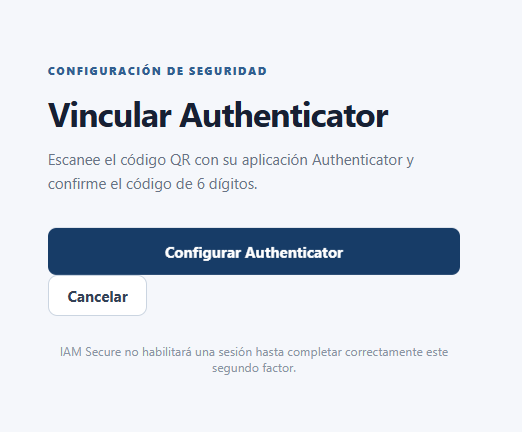
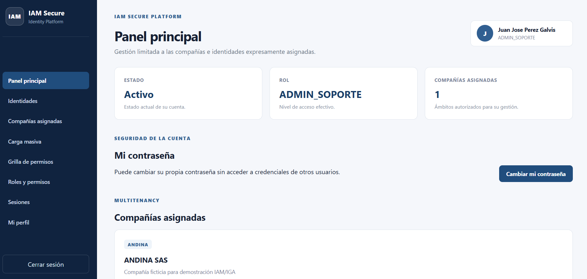
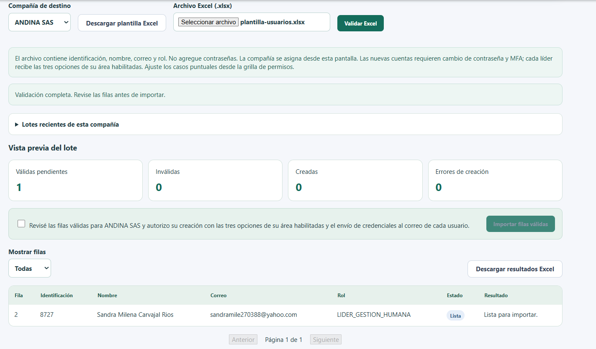
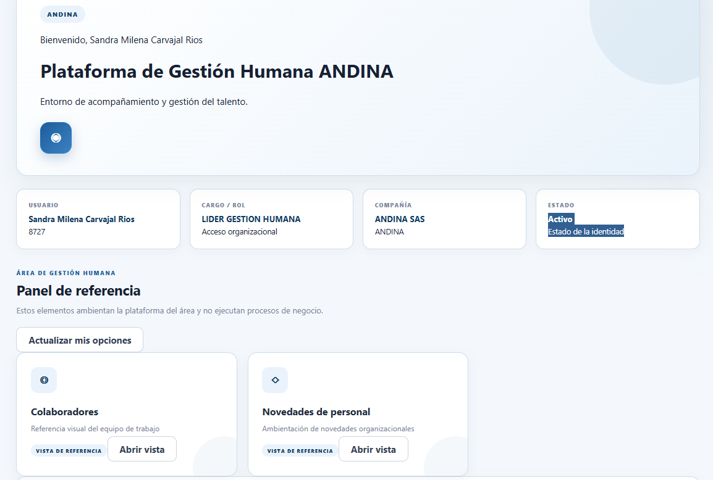

# Manual de usuario e instalación de IAM Secure en Windows y Linux

**Edición:** 17 de octubre de 2026. **Proyecto:** Grupo 1, DEVSECOPS2026_2. **Asignatura:** Seg en Entornos Cloud y Devops.

Autores: Oscar Daniel Acosta, David Enrique Diaz, Ingrid Tatiana Vesga, Jean Carlos Almenarez Ríos y Yeison Fabián Bernal López.

[Descargar el manual en PDF](MANUAL_EJECUCION_WINDOWS_LINUX.pdf). Para copiar comandos sin los saltos de línea de una página impresa, utilice esta versión de GitHub.

Este manual acompaña a otro grupo desde un PC nuevo hasta el ingreso de ADMIN_TI y ADMIN_SOPORTE, con contraseña propia, MFA, compañía asignada y una prueba funcional. No requiere conocer el código. Lea cada paso, ejecute solo el bloque de su sistema y compruebe el resultado antes de continuar.

<!-- INDICE_AUTOMATICO -->

1. [Elija el recorrido correcto](#1-elija-el-recorrido-correcto)
2. [Prepare lo necesario](#2-prepare-lo-necesario)
3. [Instale y compruebe Git y Docker en Windows](#3-instale-y-compruebe-git-y-docker-en-windows)
4. [Instale y compruebe Git y Docker en Linux](#4-instale-y-compruebe-git-y-docker-en-linux)
5. [Clone el repositorio en una carpeta nueva](#5-clone-el-repositorio-en-una-carpeta-nueva)
6. [Revise puertos y contenedores existentes](#6-revise-puertos-y-contenedores-existentes)
7. [Cree y proteja el archivo de configuración](#7-cree-y-proteja-el-archivo-de-configuración)
8. [Genere claves propias y complete las variables](#8-genere-claves-propias-y-complete-las-variables)
9. [Configure SMTP para recibir las credenciales](#9-configure-smtp-para-recibir-las-credenciales)
10. [Construya e inicie los ocho servicios](#10-construya-e-inicie-los-ocho-servicios)
11. [Compruebe las direcciones y la base](#11-compruebe-las-direcciones-y-la-base)
12. [Cree el ADMIN_TI inicial](#12-cree-el-admin_ti-inicial)
13. [Entre y active Authenticator como ADMIN_TI](#13-entre-y-active-authenticator-como-admin_ti)
14. [Cree un ADMIN_SOPORTE y asigne su compañía](#14-cree-un-admin_soporte-y-asigne-su-compañía)
15. [Entre como soporte y conozca los roles](#15-entre-como-soporte-y-conozca-los-roles)
16. [Cree un líder y pruebe la carga Excel](#16-cree-un-líder-y-pruebe-la-carga-excel)
17. [Abra la grilla y compruebe permisos](#17-abra-la-grilla-y-compruebe-permisos)
18. [Revise auditoría, sesiones e inactividad](#18-revise-auditoría-sesiones-e-inactividad)
19. [Detenga y retome sin perder las cuentas](#19-detenga-y-retome-sin-perder-las-cuentas)
20. [Resuelva errores frecuentes](#20-resuelva-errores-frecuentes)
21. [Compruebe la entrega al otro grupo](#21-compruebe-la-entrega-al-otro-grupo)
22. [Use HTTPS solo si elige el laboratorio seguro](#22-use-https-solo-si-elige-el-laboratorio-seguro)
23. [Referencias y versión del manual](#23-referencias-y-versión-del-manual)

## 1. Elija el recorrido correcto

La ruta principal de este manual reproduce el documento que el equipo utilizó en otro PC: **desarrollo local con Docker Compose, HTTP y SMTP propio**. El navegador se abre en el mismo computador que ejecuta Docker. Sus usuarios, datos y claves son independientes de los de otro equipo.

| Recorrido | Cuándo usarlo | Acceso y servicios |
|---|---|---|
| Principal, secciones 2 a 21 | Probar la aplicación completa, crear soporte y recibir sus credenciales por correo | HTTP 5173; ocho servicios; archivo .env; SMTP funcional |
| Laboratorio seguro, sección 22 | Demostrar HTTPS, roles DB mínimos y límites de autenticación | HTTPS 8443-8446; nueve servicios; carpeta .private; SMTP inválido por diseño |

**No combine los comandos de los dos recorridos.** Un resultado HTTPS no convierte el Compose principal en un entorno productivo. La instalación de otro PC no implica acceder por red al primer equipo: localhost siempre es el computador donde se abre el navegador.

La aplicación administra identidades y visibilidad de vistas académicas. Las vistas de Facturación, Logística y Gestión Humana no ejecutan procesos reales de esos negocios.

## 2. Prepare lo necesario

Necesita un PC Windows con PowerShell o un PC Linux con Bash, conexión a Internet durante la instalación, acceso de lectura al repositorio privado, Git, Docker con motor Linux y Docker Compose v2. También necesita un navegador y una aplicación Authenticator compatible con TOTP en el teléfono.

Para crear ADMIN_SOPORTE y líderes, disponga de una **cuenta SMTP de pruebas controlada por el grupo**, con remitente y credenciales válidas, y acceso a los buzones destinatarios. Sin SMTP puede preparar el ADMIN_TI inicial; no puede dar por validado el recorrido de entrega de credenciales.

No necesita instalar Node.js, PostgreSQL ni Python en el host para la ruta principal. Docker construye y ejecuta los servicios. Python 3.14 en el host se necesita solo si elige el laboratorio HTTPS opcional.

Reserve espacio para imágenes y dependencias. Docker Desktop exige comprobar virtualización y requisitos del sistema. Consulte los instaladores oficiales de la sección 23, en lugar de descargar ejecutables de terceros.

**Cómo usar los bloques:** no copie los signos de una consola, como PS> o $. En las líneas que incluyen una URL local, escriba la dirección en la barra del navegador; no es un comando de PowerShell. Cuando aparezca un mensaje de error, no siga con el siguiente paso hasta resolverlo.

## 3. Instale y compruebe Git y Docker en Windows

1. Descargue Git para Windows desde el enlace de la sección 23. Abra el instalador y conserve las opciones predeterminadas si no tiene una configuración propia.
2. Descargue Docker Desktop para la arquitectura de su PC y abra su instalador. Seleccione contenedores Linux y el backend WSL 2 si corresponde a su equipo.
3. Si el asistente indica que falta WSL 2 o virtualización, complete el requisito con el administrador del PC y siga la guía oficial. No continúe hasta que el motor pueda iniciar.
4. Reinicie si se solicita, abra Docker Desktop y espere a que termine de iniciar. La aplicación debe permanecer abierta durante la prueba.

Abra PowerShell desde el menú Inicio. Ejecute:

```powershell
git --version
docker --version
docker compose version
docker info
```

**Resultado esperado:** Git y Compose muestran una versión. docker info muestra información del servidor, sin error de conexión al motor.

Si un comando no se reconoce después de instalarlo, cierre PowerShell y abra una ventana nueva. Si docker info falla, revise Docker Desktop antes de clonar o construir imágenes. No hace falta ejecutar todo el laboratorio como administrador.

## 4. Instale y compruebe Git y Docker en Linux

La instalación de paquetes siguiente está orientada a **Ubuntu**. En Debian, Fedora u otra distribución, use el procedimiento oficial específico de Docker para esa distribución; después, los pasos Bash de la aplicación son los mismos. No instale un segundo motor si docker info y docker compose version ya funcionan.

Si Docker ya está disponible, compruebe:

```bash
git --version
docker --version
docker compose version
docker info
```

Si falta Git en Ubuntu:

```bash
sudo apt update
sudo apt install git
```

Si falta Docker Engine y el sistema es Ubuntu, configure el repositorio oficial. Estos pasos requieren la contraseña sudo de su propio equipo. Si ya hay otro motor o paquetes Docker, revise posibles conflictos con el administrador; no ejecute desinstalaciones generales sobre un equipo con otros proyectos.

```bash
. /etc/os-release
printf 'Sistema detectado: %s\n' "$PRETTY_NAME"
```

Solo si el resultado identifica Ubuntu, ejecute los bloques siguientes, esperando el resultado de cada comando:

```bash
sudo apt update
sudo apt install ca-certificates curl git
sudo install -m 0755 -d /etc/apt/keyrings
sudo curl -fsSL https://download.docker.com/linux/ubuntu/gpg -o /etc/apt/keyrings/docker.asc
sudo chmod a+r /etc/apt/keyrings/docker.asc
```

Agregue el origen de paquetes oficial para su versión de Ubuntu:

```bash
. /etc/os-release
printf '%s\n' \
  'Types: deb' \
  'URIs: https://download.docker.com/linux/ubuntu' \
  "Suites: ${UBUNTU_CODENAME:-$VERSION_CODENAME}" \
  'Components: stable' \
  "Architectures: $(dpkg --print-architecture)" \
  'Signed-By: /etc/apt/keyrings/docker.asc' \
  | sudo tee /etc/apt/sources.list.d/docker.sources > /dev/null
sudo apt update
sudo apt install docker-ce docker-ce-cli containerd.io docker-buildx-plugin docker-compose-plugin
```

Si apt indica que no hay paquetes para esa versión, deténgase y consulte las versiones soportadas en el enlace oficial; no cambie el nombre de la distribución por ensayo.

Tras instalar, si el servicio no está iniciado:

```bash
sudo systemctl start docker
sudo systemctl status docker
```

Si docker info da permission denied, un administrador del equipo debe revisar el acceso al motor. La pertenencia al grupo docker otorga privilegios administrativos sobre el host. Cuando esa pertenencia esté autorizada, puede configurarse con:

```bash
sudo usermod -aG docker "$USER"
```

Cierre su sesión de Linux, vuelva a entrar y repita docker info. Los pasos restantes asumen que docker funciona con su usuario. No cambie de forma indiscriminada permisos del socket Docker ni ejecute una terminal root permanente.

## 5. Clone el repositorio en una carpeta nueva

Elija **un repositorio**. Principal: [DevSecOps-proyecto-Final](https://github.com/jeancarlosalmenarez8318-tech/DevSecOps-proyecto-Final). Espejo: [DevSecOps-proyecto-Final-ci](https://github.com/yeisonfblopez/DevSecOps-proyecto-Final-ci). Ambos contienen el código del proyecto; GitHub puede pedir autenticarse con una cuenta colaboradora.

### Windows PowerShell

```powershell
$ErrorActionPreference = 'Stop'
$destino = Join-Path ([Environment]::GetFolderPath('MyDocuments')) 'IAM-Secure'
if (Test-Path -LiteralPath $destino) {
    throw 'La carpeta existe. Revise su contenido o elija una carpeta nueva.'
}
$url = 'https://github.com/jeancarlosalmenarez8318-tech/DevSecOps-proyecto-Final.git'
git clone $url $destino
if ($LASTEXITCODE -ne 0) { throw 'No se pudo clonar.' }
Set-Location -LiteralPath $destino
git branch --show-current
git log -1 --oneline
```

### Linux Bash

```bash
mkdir -p "$HOME/proyectos"
cd "$HOME/proyectos"
git clone https://github.com/jeancarlosalmenarez8318-tech/DevSecOps-proyecto-Final.git IAM-Secure \
  && cd IAM-Secure
git branch --show-current
git log -1 --oneline
```

**Resultado esperado:** rama master y un commit identificado. Registre ese commit para saber qué versión probó. El código de referencia anterior a esta edición es 6293194; una edición documental posterior puede tener otro SHA sin cambiar la aplicación. No cambie a las ramas antiguas feat/*.

Si el principal no está disponible y usted tiene acceso al espejo, cambie solo la URL de clone por la del espejo. No clone ambos en la misma carpeta. Repository not found puede significar falta de permisos o autenticación, aunque el repositorio exista. No ponga un token en la URL ni lo envíe por chat.

## 6. Revise puertos y contenedores existentes

La ruta principal utiliza **5173, 5176, 8003, 8004, 8005 y 5433**. El laboratorio HTTPS utiliza otros puertos y no forma parte de este paso.

### Windows PowerShell

```powershell
$ocupados = @(Get-NetTCPConnection -State Listen -ErrorAction Stop |
    Where-Object { $_.LocalPort -in @(5173,5176,8003,8004,8005,5433) })
if ($ocupados.Count -eq 0) {
    Write-Host 'Los puertos del recorrido principal estan libres.'
} else {
    $ocupados | Format-Table LocalAddress,LocalPort,OwningProcess
}
docker ps -a --filter 'name=iam-secure-'
```

### Linux Bash

```bash
ss -ltn | grep -E ':(5173|5176|8003|8004|8005|5433)[[:space:]]' || true
docker ps -a --filter 'name=iam-secure-'
```

En Linux, si ss no existe, instale la herramienta iproute2 de su distribución o pida ayuda al administrador; no interprete comando no encontrado como puertos libres. No se necesitan los PID para esta primera comprobación.

**Resultado esperado:** no hay puertos ocupados por otra aplicación ni contenedores anteriores con esos nombres. Si ya existe IAM Secure, no lo borre para continuar: revise si debe retomar esa instalación. El Compose principal fija nombres de contenedores; dos copias no se aíslan únicamente cambiando el nombre del proyecto.

No cierre procesos desconocidos ni cambie un solo puerto por ensayo: las APIs, el frontend, CORS y la grilla deben mantener una configuración coherente.

## 7. Cree y proteja el archivo de configuración

Todos los comandos restantes se ejecutan en la raíz clonada IAM-Secure, donde están docker-compose.yml y .env.example. El archivo **.env** guardará las claves y la configuración SMTP propias de este PC.

### Windows PowerShell

```powershell
if (Test-Path -LiteralPath .env) {
    throw 'Ya existe .env. No lo reemplace sobre una instalacion anterior.'
}
Copy-Item -LiteralPath .env.example -Destination .env
$sid = [System.Security.Principal.WindowsIdentity]::GetCurrent().User.Value
icacls .env /inheritance:r /grant:r "*${sid}:(F)"
if ($LASTEXITCODE -ne 0) { throw 'No se pudieron restringir los permisos de .env.' }
git check-ignore -v .env
notepad .env
```

### Linux Bash

```bash
if [ -e .env ]; then
  printf '%s\n' 'Ya existe .env. No lo reemplace.'
else
  umask 077
  cp .env.example .env
  chmod 600 .env
fi
git check-ignore -v .env
nano .env
```

En Linux, si .env ya existe, no vuelva a generar sus claves: revise la instalación previa antes de seguir. Si nano no está disponible, use un editor de texto de su elección. En nano, Ctrl+O guarda, Enter confirma el nombre y Ctrl+X sale.

**Resultado esperado:** git check-ignore muestra la regla que excluye .env. No continúe introduciendo secretos si el archivo no está ignorado. No comparta este archivo por Git, correo, capturas o chat. Las ACL protegen el acceso ordinario de otros usuarios; no aíslan el archivo frente a un administrador del equipo.

## 8. Genere claves propias y complete las variables

Deje el editor de .env abierto. En otra terminal ubicada en la misma carpeta ejecute el comando siguiente **cuatro veces**, una vez por cada variable POSTGRES_PASSWORD, DEMO_IDENTITY_PASSWORD, JWT_SECRET y AUDIT_INTERNAL_TOKEN. Cada ejecución debe producir un valor diferente:

```console
docker run --rm python:3.14-slim python -c "import secrets;print(secrets.token_hex(32))"
```

Copie cada valor únicamente en su línea correspondiente de .env. Estos comandos imprimen claves nuevas en su terminal local: no capture ni publique esa salida. DEMO_IDENTITY_PASSWORD es una variable de compatibilidad del ejemplo; no es la contraseña inicial del administrador.

Para **MFA_ENCRYPTION_KEY**, genere 32 bytes en base64 URL-safe con el relleno que necesita Fernet:

```console
docker run --rm python:3.14-slim python -c "import secrets;print(secrets.token_urlsafe(32)+'=')"
```

| Variable | Qué debe quedar guardado |
|---|---|
| POSTGRES_PASSWORD | Valor aleatorio exclusivo para esta base nueva |
| DEMO_IDENTITY_PASSWORD | Otro valor aleatorio; no reutilizar una clave |
| JWT_SECRET | Secreto independiente para firmar tokens |
| MFA_ENCRYPTION_KEY | Clave Fernet generada con el comando específico |
| AUDIT_INTERNAL_TOKEN | Otro secreto independiente, solo para auditoría interna |
| SMTP_HOST, SMTP_PORT, SMTP_USER, SMTP_PASSWORD, SMTP_FROM | Valores de su proveedor y cuenta de pruebas |
| BOOTSTRAP_ADMIN_TI_PASSWORD | Déjela vacía; se introducirá de forma oculta en el paso 12 |

Conserve estas políticas y URLs locales, salvo una necesidad revisada por el equipo:

```dotenv
JWT_ALGORITHM=HS256
JWT_EXPIRE_MINUTES=30
TEMP_PASSWORD_EXPIRE_HOURS=24
PASSWORD_EXPIRE_DAYS=60
PASSWORD_RECOVERY_COOLDOWN_MINUTES=15
SESSION_INACTIVITY_MINUTES=5
VITE_SESSION_INACTIVITY_MINUTES=5
CORS_ORIGINS=http://localhost:5173,http://127.0.0.1:5173
VITE_API_URL=
BOOTSTRAP_ADMIN_TI_PASSWORD=
AUDIT_SERVICE_URL=http://audit-service:8004
AUDIT_HTTP_TIMEOUT_SECONDS=2
```

Compose conserva los valores locales de Permissions y la grilla. Nunca coloque secretos en VITE_. Guarde .env y conserve la clave MFA original mientras conserve su base; reemplazarla puede impedir descifrar los MFA anteriores.

## 9. Configure SMTP para recibir las credenciales

Solicite al proveedor SMTP el host, puerto, usuario autorizado, contraseña o contraseña de aplicación y remitente permitido. Use una cuenta de pruebas y buzones controlados por el grupo. No se proporciona una cuenta compartida ni una contraseña universal para el proyecto.

```dotenv
SMTP_HOST=HOST_DE_SU_PROVEEDOR
SMTP_PORT=587
SMTP_USER=USUARIO_DE_SU_CUENTA
SMTP_PASSWORD=SECRETO_DE_SU_CUENTA
SMTP_FROM=REMITENTE_AUTORIZADO
```

Los valores anteriores son **marcadores**, no una configuración que funcione por sí sola. El código usa SMTP con STARTTLS, normalmente en el puerto 587. No configure 465 como si se activara SSL implícito: esta versión no implementa SMTP_SSL. Solicite un servicio compatible con STARTTLS. Si el proveedor exige una contraseña de aplicación, utilice esa credencial.

Guarde el valor SMTP exactamente como lo entrega su proveedor. Si contiene espacios, # o $, revise la sintaxis de .env: las comillas simples conservan el valor literal y evitan la interpolación de $. No copie los marcadores anteriores como si fueran secretos reales. Consulte la referencia de variables Compose de la sección 23 si el valor incluye comillas.

**Qué depende del correo:** creación de soportes, creación individual de líderes, importación Excel y recuperación de contraseña. El bootstrap del ADMIN_TI no envía su contraseña por SMTP: usted la elige de forma privada en el paso 12.

Si todavía no tiene SMTP, puede seguir hasta el acceso del ADMIN_TI, dejando pendiente la creación de otros usuarios. No sustituya los destinatarios por correos de terceros ni ejecute identity-bootstrap: ese servicio utiliza un catálogo académico de trece identidades, distinto de la cuenta inicial de este manual.

Si necesita corregir SMTP después de iniciar una instalación con datos, conserve los secretos originales de DB/JWT/MFA y recree solo Identity para cargar el cambio:

```console
docker compose up -d --no-deps --force-recreate identity
```

Esta operación se usa **solo cuando Identity ya fue iniciado**; no corresponde a la primera preparación de .env. No elimina la base. Vuelva a comprobar la API y el envío mediante una operación autorizada sobre una cuenta de pruebas propia.

## 10. Construya e inicie los ocho servicios

Antes de construir, compruebe que ha guardado el editor y reemplazado los marcadores de secretos. Use docker compose con espacio; no docker-compose v1.

Estos comandos son iguales en PowerShell y Bash:

```console
docker compose config --quiet
git check-ignore -v .env
docker compose build
docker compose up -d --wait --wait-timeout 180
docker compose ps
```

Ejecute cada línea por separado y espere a que termine antes de la siguiente. La primera construcción puede tardar varios minutos. Necesita Internet para las imágenes y dependencias. config --quiet sin errores comprueba la estructura del Compose, pero no prueba que las claves o el SMTP sean correctos. No use config sin --quiet al compartir evidencias: puede mostrar valores resueltos.

| Servicio normal | Qué debe observar |
|---|---|
| postgres | Running o Up; healthy |
| identity | Running o Up; API de identidad |
| frontend | Running o Up; portal |
| permissions | Running o Up; API de permisos |
| permissions-grid | Running o Up; grilla |
| sync-worker | Running o Up; proceso sin pantalla propia |
| audit-service | Running o Up; API de auditoría |
| audit-dispatcher | Running o Up; entrega de eventos |

identity-bootstrap no debe quedar ejecutándose. Es un servicio puntual y este recorrido no lo necesita. El build construye código desde el repositorio; descargar imágenes históricas 1.0.0 no equivale a ejecutar estos cambios.

## 11. Compruebe las direcciones y la base

| Componente | Dirección en el mismo PC |
|---|---|
| Panel principal | http://localhost:5173/ |
| Identity y documentación API | http://localhost:8003/ y http://localhost:8003/docs |
| Permissions | http://127.0.0.1:8005/ |
| Audit health | http://127.0.0.1:8004/health |
| PostgreSQL para herramientas del operador | localhost:5433 |
| Grilla | Se abre desde el panel; sirve en http://localhost:5176/permissions.html |

### Windows PowerShell

```powershell
curl.exe --fail http://localhost:5173/
curl.exe --fail http://localhost:8003/
curl.exe --fail http://127.0.0.1:8005/
curl.exe --fail http://127.0.0.1:8004/health
```

### Linux Bash

```bash
curl --fail http://localhost:5173/
curl --fail http://localhost:8003/
curl --fail http://127.0.0.1:8005/
curl --fail http://127.0.0.1:8004/health
```

**Resultado esperado:** el panel devuelve HTML y las APIs responden sin errores. Que un contenedor esté Up no basta para dar por probado el ingreso, el correo o los permisos.

Para verificar una tabla de la instalación nueva, en cualquiera de las terminales:

```console
docker compose exec -T postgres psql -U postgres -d iam_secure -Atc "SELECT to_regclass('cargas_usuarios')"
```

Debe aparecer cargas_usuarios. Los scripts postgres-init se ejecutan automáticamente sobre un volumen nuevo. Si reutiliza una base anterior y falta una tabla o función, deténgase y siga el procedimiento de migración del [manual de despliegue](../despliegue/DESPLIEGUE.md). No elimine el volumen como solución.

## 12. Cree el ADMIN_TI inicial

El primer administrador no puede crearse desde la pantalla porque aún no hay una sesión que lo autorice. Ejecute bootstrap_admin_ti.py una sola vez para esta base nueva. La contraseña temporal debe tener mínimo doce caracteres, una letra y un carácter especial. No la reutilice como contraseña definitiva.

La cuenta académica del script es **CamiloCoordiTI@areati.demo**, con ID externo 1051 y rol ADMIN_TI. No es la cuenta GitHub ni su buzón SMTP. Clonar el repositorio no crea automáticamente esta cuenta.

### Windows PowerShell

```powershell
$clave = Read-Host 'Clave temporal del ADMIN_TI' -AsSecureString
$anterior = $env:BOOTSTRAP_ADMIN_TI_PASSWORD
try {
    $env:BOOTSTRAP_ADMIN_TI_PASSWORD = [System.Net.NetworkCredential]::new('', $clave).Password
    docker compose run --rm -e BOOTSTRAP_ADMIN_TI_PASSWORD identity python bootstrap_admin_ti.py
    if ($LASTEXITCODE -ne 0) { throw 'No se completo el bootstrap.' }
} finally {
    $env:BOOTSTRAP_ADMIN_TI_PASSWORD = $anterior
    $clave = $null
    $anterior = $null
}
```

### Linux Bash

```bash
read -r -s -p 'Clave temporal del ADMIN_TI: ' BOOTSTRAP_ADMIN_TI_PASSWORD
printf '\n'
export BOOTSTRAP_ADMIN_TI_PASSWORD
docker compose run --rm -e BOOTSTRAP_ADMIN_TI_PASSWORD identity python bootstrap_admin_ti.py
resultado=$?
unset BOOTSTRAP_ADMIN_TI_PASSWORD
if [ "$resultado" -ne 0 ]; then
  printf '%s\n' 'No se completo el bootstrap. Revise antes de seguir.'
fi
```

La contraseña se introduce sin aparecer en la pantalla ni en el texto del comando. El proceso almacena su hash y deja el cambio obligatorio activado. Espere el mensaje ADMIN_TI inicial creado correctamente.

Si informa que el ADMIN_TI ya existe, no lo duplica ni cambia su contraseña. Use la cuenta de esa base con sus credenciales originales; volver a ejecutar el bootstrap no restablece el acceso.

## 13. Entre y active Authenticator como ADMIN_TI

Abra http://localhost:5173/ en el navegador del mismo equipo. Introduzca **CamiloCoordiTI@areati.demo** y la contraseña temporal que acaba de elegir.

Siga el orden que muestre la pantalla: la aplicación puede pedir primero configurar Authenticator y después cambiar la contraseña. Complete ambos pasos; una sesión temporal no habilita todas las operaciones.

1. Cuando aparezca Configurar Authenticator, pulse ese botón.
2. En el teléfono abra su aplicación autenticadora y elija agregar una cuenta mediante QR.
3. Escanee el QR privado que muestra IAM Secure. No lo guarde en capturas ni lo comparta.
4. Introduzca en IAM Secure el código vigente de seis dígitos y confirme.
5. Si se solicita cambiar la contraseña, escriba la temporal como actual y elija una definitiva propia; confirme los campos. Debe tener mínimo doce caracteres, una letra, un número y un carácter especial.
6. Compruebe que el panel identifica el rol ADMIN_TI y muestra Administradores de soporte, Compañías e Informe de auditoría.
7. Cierre sesión y vuelva a ingresar con la contraseña definitiva y un código nuevo de su autenticador.



La captura es una referencia de navegación ya versionada. No muestra el QR y no acredita por sí sola la activación. Los códigos vencen: si uno cambia mientras lo escribe, espere al siguiente; mantenga sincronizada la fecha y hora del teléfono. No desactive MFA para resolver un problema de reloj.

**Resultado esperado:** puede entrar al panel con contraseña definitiva y MFA. Este es el punto de control antes de crear otros administradores.

## 14. Cree un ADMIN_SOPORTE y asigne su compañía

Se necesita SMTP funcional y un correo destinatario controlado por el grupo. ADMIN_TI no define ni ve la contraseña temporal del soporte: la aplicación la genera y la envía al correo registrado.

1. Con sesión ADMIN_TI, abra Administradores de soporte.
2. Pulse + Nuevo ADMIN_SOPORTE.
3. Escriba un identificador nuevo, de máximo cincuenta caracteres; use texto si necesita ceros iniciales.
4. Escriba el nombre, máximo cien caracteres, y el correo real del destinatario.
5. Verifique que el rol es ADMIN_SOPORTE y pulse Crear ADMIN_SOPORTE.
6. Espere el mensaje de confirmación y compruebe la llegada del correo, incluida la carpeta de spam.
7. En la fila del soporte pulse Gestionar compañías.
8. Marque una compañía activa, por ejemplo ANDINA SAS, y pulse Guardar alcance.
9. Compruebe que la fila muestra el alcance asignado.

La base nueva incluye ANDINA SAS, PACIFICO SAS y CARIBE SAS. Asigne únicamente las compañías necesarias para la demostración. Una cuenta de soporte sin compañía no obtiene acceso general a todas las compañías.

**Si el envío falla:** no repita Crear sin revisar el mensaje y la lista de cuentas. Verifique SMTP en la sección 20; un error de correo no se resuelve introduciendo datos de otro grupo. No ejecute el bootstrap de trece cuentas para sustituir este recorrido.

## 15. Entre como soporte y conozca los roles

Cierre la sesión ADMIN_TI o use otra ventana de navegador para evitar confundir cuentas. Abra el correo del soporte, utilice su contraseña temporal y complete su propio cambio de contraseña y enrolamiento MFA siguiendo las pantallas.

**Resultado esperado:** el panel muestra ADMIN_SOPORTE y solo sus compañías asignadas. Están disponibles las funciones de Identidades, Carga masiva y Grilla de permisos dentro de ese alcance.



| Rol | Para qué se utiliza |
|---|---|
| ADMIN_TI | Administra soportes, compañías y asignaciones; consulta el informe de auditoría |
| ADMIN_SOPORTE | Administra líderes de sus compañías activas; importa Excel y gestiona permisos |
| LIDER_FACTURACION | Consulta las opciones autorizadas de Facturación |
| LIDER_LOGISTICA | Consulta las opciones autorizadas de Logística |
| LIDER_GESTION_HUMANA | Consulta las opciones autorizadas de Gestión Humana |

El servidor comprueba el alcance de cada operación. ADMIN_TI no sustituye al soporte para administrar las identidades internas de una compañía. Un líder no administra otros usuarios.

## 16. Cree un líder y pruebe la carga Excel

### Una identidad individual

Como ADMIN_SOPORTE, abra Identidades y pulse Nueva identidad. Complete identificador, nombre, correo controlado por el grupo, uno de los tres roles de líder y una compañía activa asignada a usted. Confirme la creación, compruebe el correo y pruebe el primer acceso del líder con su contraseña propia y su MFA.

### Una carga de Excel

1. Abra Carga masiva de identidades y elija una compañía asignada.
2. Descargue la plantilla desde la propia aplicación; no reconstruya sus columnas por ensayo.
3. Prepare primero una sola fila de prueba con identificador y correo nuevos.
4. Guarde el archivo como .xlsx y selecciónelo en Archivo Excel.
5. Pulse Validar Excel y revise el resultado por fila. Validar no crea cuentas ni envía correos.
6. Corrija las filas inválidas si las hay. Marque la autorización de creación y envío.
7. Pulse Importar filas válidas, espere el resultado y compruebe la llegada del correo.
8. Descargue los resultados y conserve solo evidencia sin contraseñas ni datos privados innecesarios.

| Columna | Contenido |
|---|---|
| id_externo | Texto, entre uno y cincuenta caracteres; conservar ceros iniciales |
| nombre | Texto, máximo cien caracteres |
| email | Correo válido y propio de la prueba, máximo ciento cincuenta caracteres |
| rol | LIDER_FACTURACION, LIDER_LOGISTICA o LIDER_GESTION_HUMANA |

Una compañía por lote, máximo quinientas filas y 2 MiB. No use fórmulas, macros ni vínculos externos. Escriba los roles con guiones bajos, tal como aparecen en la plantilla.



Una fila duplicada queda inválida y no modifica la cuenta existente. Un fallo de SMTP puede revertir la creación de esa fila. Puede consultar el lote persistido y retomar filas pendientes desde Lotes recientes; no vuelva a importar ciegamente todo un archivo ya procesado.

## 17. Abra la grilla y compruebe permisos

Como ADMIN_SOPORTE, abra **Grilla de permisos desde el panel autenticado**. No use la URL directa como si fuera otra pantalla de login: la ventana recibe una sesión temporal desde el portal.

1. Seleccione la compañía y busque el líder creado para la prueba.
2. Revise la opción que desea permitir o restringir.
3. Cambie su interruptor y confirme la operación.
4. Como líder, pulse Actualizar mis opciones y compruebe el cambio.
5. Restaure la opción si su prueba requiere conservar el estado inicial.



La captura ilustra las tarjetas del líder, no una nueva ejecución de esta edición. Revise rol y compañía cuando una función no aparezca: no todos los usuarios deben ver lo mismo. Si recibe 409 por un cambio concurrente, recargue la grilla y revise el estado actual antes de repetir la acción.

## 18. Revise auditoría, sesiones e inactividad

Con ADMIN_TI abra Informe de auditoría. Elija un rango de fechas permitido y los filtros que necesite; genere el archivo XLSX y revise que las acciones de la prueba aparezcan. La entrega por outbox es asíncrona: espere unos segundos si una acción acaba de ocurrir y vuelva a consultar.

El informe admite hasta treinta y un días y cinco mil eventos; si el rango es demasiado amplio, reduzca fechas o filtros. El informe no exporta las contraseñas o semillas MFA. Compartir un XLSX de auditoría puede revelar nombres y correos de la prueba: revise su contenido antes de entregarlo a otro grupo.

En Mi perfil puede consultar los datos de la cuenta y las opciones de contraseña que autorice la aplicación. En Sesiones puede revisar y revocar las sesiones incluidas en su alcance. Revocar una sesión la invalida en el servidor.

La política de inactividad es de **cinco minutos**. Para probarla, deje de interactuar con portal y grilla y compruebe que la sesión expira. Reingrese desde el portal con contraseña definitiva y MFA; no vuelva a hacer bootstrap ni cambie claves de .env para resolver una expiración normal.

## 19. Detenga y retome sin perder las cuentas

Para detener los procesos conservando contenedores y datos, desde la raíz de este mismo proyecto:

```console
docker compose stop
```

Otro día, abra Docker Desktop si usa Windows, entre a la **misma carpeta** y ejecute:

```console
docker compose up -d --wait --wait-timeout 180
docker compose ps
```

Vuelva a entrar con la contraseña definitiva y el autenticador ya enrolado. No use la contraseña temporal después de cambiarla.

También puede usar docker compose down para retirar contenedores y red conservando el volumen predeterminado. Para una primera prueba de persistencia, stop y up son suficientes y más fáciles de seguir.

**No use down -v si necesita conservar datos.** Elimina el volumen y con él las cuentas, MFA, asignaciones y auditoría locales. No borre .env, no regenere la clave MFA y no cambie el nombre/carpeta del proyecto sin revisar qué volumen usará Compose. Git no es una copia de seguridad de la base ni de sus secretos.

Si actualiza código sobre una instalación existente, conserve cambios propios y siga las migraciones del manual de despliegue. Los scripts de inicio de PostgreSQL no se repiten simplemente por reconstruir imágenes. La migración 13 debe estar aplicada antes de ejecutar Permissions con las funciones de bloqueo nuevas.

## 20. Resuelva errores frecuentes

| Lo que aparece | Acción recomendada |
|---|---|
| git no se reconoce | Instalar Git y abrir una terminal nueva |
| Repository not found | Revisar permiso de lectura y autenticación GitHub |
| Docker no responde | Iniciar el motor; comprobar docker info antes de continuar |
| permission denied en Linux | Revisar con el administrador el acceso al motor, sin abrir el socket a todos |
| port is already allocated | Identificar el proceso o contenedor del paso 6; no borrar volúmenes |
| Nombre iam-secure ya utilizado | Hay una instalación previa; revisarla o retomarla, sin sobrescribirla |
| config --quiet falla | Revisar sintaxis de .env y que se ejecuta desde la raíz correcta |
| Error de clave Fernet al iniciar | Revisar que se usó la clave MFA válida y se conservó el valor original |
| ADMIN_TI no existe | Ejecutar el bootstrap específico del paso 12 en la base de este PC |
| ADMIN_TI ya existe | Usar sus credenciales originales; bootstrap no es un reset de contraseña |
| Código MFA rechazado | Sincronizar reloj del teléfono, usar el código vigente y verificar la cuenta del autenticador |
| No llega correo al soporte | Revisar proveedor, remitente permitido, contraseña de aplicación y spam; no insistir en crear duplicados |
| Soporte no ve compañías | Volver con ADMIN_TI, revisar compañía activa y Guardar alcance |
| Grilla queda sin sesión | Abrirla desde el panel con una sesión vigente y la misma versión de frontend |
| Excel rechaza datos | Revisar columnas, rol exacto, duplicados, tamaño, compañía y correo |
| Sesión expirada | Volver al portal e ingresar; cinco minutos sin interacción es el comportamiento previsto |
| Falta una tabla o función en base antigua | Aplicar migración revisada; no destruir la base para que el inicializador se repita |
| Servicio reinicia tras cambiar POSTGRES_PASSWORD | El archivo no cambia la clave de un volumen existente; recuperar configuración y planear la rotación |

Diagnóstico básico para Windows y Linux:

```console
docker compose ps
docker compose logs --tail 40 identity permissions
docker compose logs --tail 40 sync-worker audit-service audit-dispatcher
```

Revise los logs localmente. Para pedir ayuda, indique paso, sistema, commit, mensaje de error y estado del servicio; oculte datos personales. No envíe .env, cabeceras de autorización, contraseñas, QR, códigos o dumps. No use docker inspect sin filtrar para compartir evidencias: muestra variables de entorno.

## 21. Compruebe la entrega al otro grupo

| Comprobación | Cómo darla por terminada |
|---|---|
| Código identificado | Se registró el SHA de git log -1 --oneline |
| Configuración propia | .env está ignorado por Git, protegido y sin marcadores de secretos |
| Servicios | Ocho servicios principales activos y PostgreSQL healthy |
| Accesos | Portal y tres APIs responden en las direcciones del paso 11 |
| ADMIN_TI | Bootstrap correcto y nuevo login con contraseña definitiva y MFA |
| ADMIN_SOPORTE | Correo recibido, compañía asignada y nuevo login con contraseña definitiva y MFA |
| Alcance | Soporte ve solo sus compañías; líder consulta sus opciones autorizadas |
| Operación funcional | Se probó creación de identidad o una fila de Excel con datos propios |
| Grilla y auditoría | Cambio autorizado comprobado e informe revisado |
| Persistencia | Tras stop y up, siguen disponibles cuentas, MFA y asignaciones |

Conserve capturas del panel posterior al login y de los resultados, con datos sintéticos o anonimizados. No capture el QR ni la contraseña temporal. Comparta este manual y el acceso al repositorio; cada grupo aporta sus propias credenciales SMTP y crea su propia configuración.

En esta conversación el usuario confirmó el funcionamiento en otro PC y el recorrido de contraseña definitiva, activación MFA y nuevo login. Es una confirmación humana; no reemplaza un recibo automático ni permite atribuir una prueba completa nueva a todas las distribuciones Linux o a todos los roles.

## 22. Use HTTPS solo si elige el laboratorio seguro

Este apartado es una **alternativa**, no el siguiente paso de la instalación HTTP. Utiliza orquestacion/compose.secure-lab.json, volumen nuevo, claves propias, nueve servicios, APIs/DB privadas y puertos 8443-8446 publicados solo en loopback. No copie el .env anterior ni reutilice su volumen.

Consulte [el procedimiento completo del perfil seguro](../seguridad/STRIDE_HARDENING_LAB.md). Para Windows y Linux se requiere Python 3.14 local con cryptography 50.0.1, Docker accesible con su usuario y los puertos 8443-8446 libres. En Linux no ejecute el generador como root.

### Preparación en Windows

Desde una copia nueva del repositorio, en PowerShell:

```powershell
py -3.14 -m venv .venv
if ($LASTEXITCODE -ne 0) { throw 'No se pudo crear el entorno Python.' }
$py = (Resolve-Path '.venv/Scripts/python.exe').Path
& $py -m pip install --only-binary=:all: 'cryptography==50.0.1'
if ($LASTEXITCODE -ne 0) { throw 'No se pudo instalar cryptography.' }
& $py scripts/create_secure_lab_config.py .private/manual-seguro
if ($LASTEXITCODE -ne 0) { throw 'No se creo la configuracion nueva.' }
$env:IAM_LAB_PRIVATE_DIR = (Resolve-Path '.private/manual-seguro').Path
$valores = Get-Content .private/manual-seguro/runtime.env -Raw | ConvertFrom-StringData
foreach ($nombre in $valores.Keys) {
    [Environment]::SetEnvironmentVariable($nombre, $valores[$nombre], 'Process')
}
$dc = @('--project-name','iam-stride-manual','--project-directory',(Get-Location).Path,
    '--env-file','.private/manual-seguro/runtime.env','-f','orquestacion/compose.secure-lab.json')
function Lab {
    docker compose @dc @args
    if ($LASTEXITCODE -ne 0) { throw 'Fallo el comando del perfil seguro.' }
}
Lab config --quiet
Lab --profile bootstrap build
Lab up -d --wait --wait-timeout 120 postgres
$idPg = @(Lab ps -q postgres)
if ($idPg.Count -ne 1) { throw 'PostgreSQL no es unico.' }
$pg = (docker inspect $idPg[0] --format '{{.Name}}').TrimStart('/')
& $py scripts/provision_runtime_roles.py --container $pg --roles-file .private/manual-seguro/roles.json
if ($LASTEXITCODE -ne 0) { throw 'No se provisionaron los roles.' }
Lab run --rm --no-deps bootstrap-admin
Lab up -d --wait --wait-timeout 180
```

### Preparación en Linux

Desde una copia nueva, como usuario no root. python3.14 debe estar disponible con soporte venv; si la distribución no lo proporciona, siga la instalación oficial de Python antes de continuar. No sustituya silenciosamente la versión.

```bash
python3.14 -m venv .venv
.venv/bin/python -m pip install --only-binary=:all: 'cryptography==50.0.1'
.venv/bin/python scripts/create_secure_lab_config.py .private/manual-seguro
export IAM_LAB_PRIVATE_DIR="$(pwd)/.private/manual-seguro"
set -a
. .private/manual-seguro/runtime.env
set +a
lab() {
  docker compose --project-name iam-stride-manual --project-directory "$PWD" \
    --env-file .private/manual-seguro/runtime.env \
    -f orquestacion/compose.secure-lab.json "$@"
}
lab config --quiet
lab --profile bootstrap build
lab up -d --wait --wait-timeout 120 postgres
pg_id=$(lab ps -q postgres)
pg=$(docker inspect "$pg_id" --format '{{.Name}}')
pg=${pg#/}
.venv/bin/python scripts/provision_runtime_roles.py \
  --container "$pg" --roles-file .private/manual-seguro/roles.json
lab run --rm --no-deps bootstrap-admin
lab up -d --wait --wait-timeout 180
```

Ejecute cada línea verificando su resultado, especialmente la generación de configuración y el aprovisionamiento de roles. Las variables se cargan en una terminal dedicada para que otros valores heredados no prevalezcan. El generador rechaza una carpeta existente; no lo repita sobre claves que ya utiliza un volumen.

### Confianza y primer acceso HTTPS

Primero verifique la CA nueva, sin desactivar TLS.

Windows PowerShell:

```powershell
curl.exe --cacert .private/manual-seguro/ca.pem --fail https://localhost:8443/
```

Linux Bash:

```bash
curl --cacert .private/manual-seguro/ca.pem --fail https://localhost:8443/
```

Antes de confiar en ella, compare su huella con ca_sha256 emitido por el generador. Para autorizar su uso en el navegador, revise e importe únicamente **el certificado público ca.pem** mediante el procedimiento de su equipo: en Windows, almacén de raíces del usuario actual; en Linux, el almacén del navegador o la configuración de certificados revisada por su administrador. Firefox puede utilizar un almacén propio. No copie claves privadas ni instale la CA de otro PC.

Abra https://localhost:8443/. La cuenta inicial es la misma identidad académica, pero su contraseña temporal está en BOOTSTRAP_ADMIN_TI_PASSWORD del archivo privado recién generado. En Windows puede copiar solo esa variable con Set-Clipboard -Value $valores['BOOTSTRAP_ADMIN_TI_PASSWORD']; en Linux consúltela localmente en su editor privado. Complete contraseña propia y MFA; no publique el archivo ni el QR.

**Límite del perfil:** SMTP está configurado como inválido. No acredita creación de soportes con entrega real de correo ni sustituye la ruta principal con SMTP. El certificado del servidor dura treinta días; el tráfico interno Docker no usa mTLS. No basta cambiar localhost por una IP para acceder desde otra máquina.

Para detener use Lab stop o lab stop. Para retomar, cargue la misma configuración y función; ejecute Lab up -d --wait o lab up -d --wait. **Conserve claves y volumen; no repita el bootstrap.**

## 23. Referencias y versión del manual

Esta edición reorganiza y amplía el manual de ejecución de once páginas aportado por el usuario, fechado el 16 de octubre de 2026. Los procedimientos se contrastaron con docker-compose.yml, .env.example, bootstrap_admin_ti.py, el frontend y las guías del repositorio. El documento adjunto sirve como referencia; sus comandos no se ejecutan automáticamente al leerlo.

La aplicación base corresponde al código 6293194. Las nuevas confirmaciones se registran como evidencia humana, diferenciadas de CI, instalaciones automatizadas y decisiones de riesgo. Los screenshots son referencias existentes y no pretenden cubrir visualmente cada operación nueva de este manual.

- [Docker Desktop en Windows](https://docs.docker.com/desktop/setup/install/windows-install/).
- [Docker Engine en Ubuntu](https://docs.docker.com/engine/install/ubuntu/) y [otras distribuciones](https://docs.docker.com/engine/install/).
- [Acceso al motor en Linux](https://docs.docker.com/engine/install/linux-postinstall/).
- [Sintaxis y variables de Compose](https://docs.docker.com/compose/how-tos/environment-variables/variable-interpolation/).
- [Git para Windows](https://git-scm.com/downloads/win).
- [Python y entornos virtuales](https://docs.python.org/3.14/library/venv.html).
- [Manual de funciones del usuario](MANUAL_USUARIO.md).
- [Despliegue y migraciones](../despliegue/DESPLIEGUE.md).
- [Perfil seguro y sus límites](../seguridad/STRIDE_HARDENING_LAB.md).
- [README principal](../../README.md).

Si los archivos del repositorio cambian, revise el SHA y los procedimientos antes de tratar esta edición como instrucciones exactas de otra versión. Los límites de seguridad, los datos personales y los secretos deben conservar su tratamiento en cualquier actualización.
