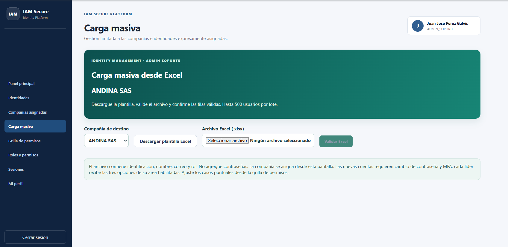
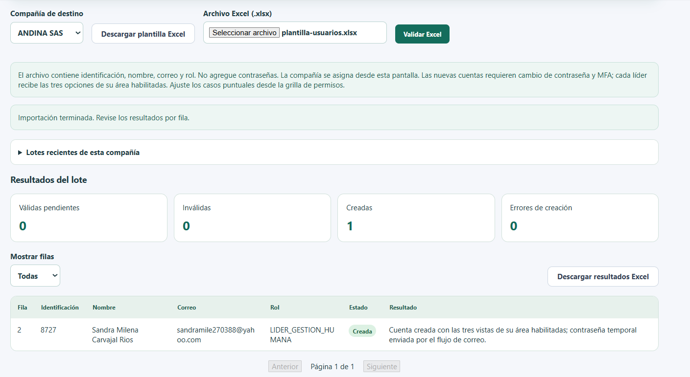
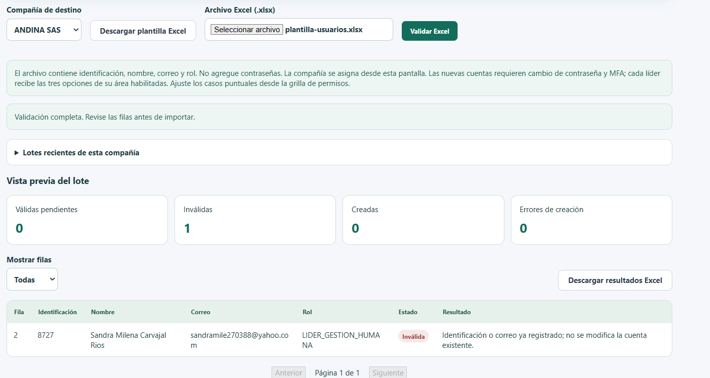
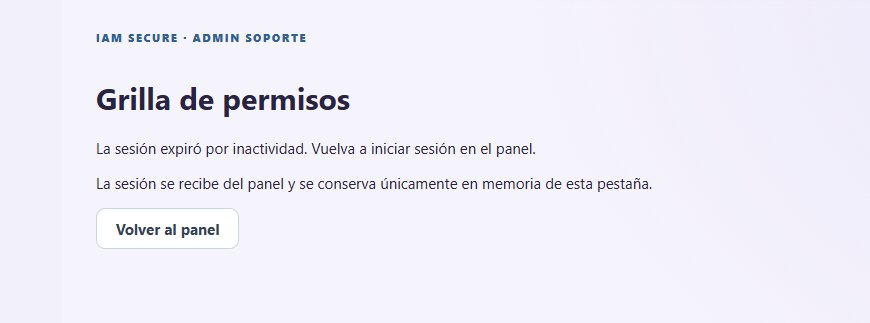

# Manual de Usuario — IAM Secure

## Guía de instalación vigente — 17 de octubre de 2026

Para ejecutar en otro PC, siga el [manual detallado Windows/Linux](../usuario/MANUAL_EJECUCION_WINDOWS_LINUX.md) o su [PDF](../usuario/MANUAL_EJECUCION_WINDOWS_LINUX.pdf). Incluye configuración propia, SMTP, primer acceso/MFA y pruebas funcionales. [Checkpoint actual](../CHECKPOINT_PRUEBA_PROYECTOFINAL_2026-10-17.md). La confirmación humana de primer acceso/MFA en otro PC no acepta riesgos residuales.

## Corte histórico E29 - 14 de octubre de 2026

[E29: cobertura CI y Quality Gate](../evidencias/2026-10-14/sonar-cobertura-ci/README.md): **f87243e, CI 31/31 y Quality Gate passed**. Cobertura nueva Sonar **88,1 %**, mínimo 80 %; cobertura global Sonar **54,5 %**. XML Python y LCOV generados en la misma ejecución; 26 controles DAST, 11 SCA y 21 de automatización. Las instalaciones nuevas usan wheels con hashes y locks, y el CI directo del espejo exige el Quality Gate. Los cortes E25/E27 son históricos; los riesgos STRIDE, la release 1.0.0 y los alcances GET-only conservan sus límites.

El [informe PDF](../informe/INFORME_TECNICO_IAM_SECURE_2026-10-14_CIERRE_SONAR.pdf) está generado y revisado (21 páginas, índice/autores/orden solicitado). [Avance vigente](../AVANCE_ACTUAL_2026-10-14.md) y [checkpoint de equipo](../CHECKPOINT_PRUEBA_PROYECTOFINAL_2026-10-14.md) describen el corte histórico; los documentos fechados al 6/7 de octubre son históricos. Video/capturas finales, seis riesgos no aceptados, visibilidad y decisión de nueva release siguen pendientes.

Revisado: 14 de octubre de 2026. Guía del código integrado en master mediante PR #3, con capturas reales aportadas por el usuario durante las pruebas. No contiene contraseñas, tokens, QR legibles ni códigos TOTP.

## 1. Acceso y alcance

Abrir http://localhost:5173/ en el entorno local. Las funciones disponibles dependen del rol y la compañía; el servidor comprueba el alcance en cada operación. Tener acceso al repositorio GitHub no crea una cuenta IAM ni copia usuarios de otro PC.

Las vistas de Facturación, Logística y Gestión Humana son referencias académicas. Administrar su visibilidad no ejecuta procesos reales de negocio.

## 2. Roles

| Rol | Funciones |
|---|---|
| ADMIN_TI | Crear/administrar ADMIN_SOPORTE; gestionar compañías y sus asignaciones; restablecer acceso/MFA y revocar sesiones de soportes según la política; descargar el informe de auditoría |
| ADMIN_SOPORTE | Administrar líderes de sus compañías activas; crear identidades individuales o por Excel; gestionar excepciones de permisos |
| LIDER_FACTURACION | Consultar vistas autorizadas de Facturación |
| LIDER_LOGISTICA | Consultar vistas autorizadas de Logística |
| LIDER_GESTION_HUMANA | Consultar vistas autorizadas de Gestión Humana |

Un soporte no puede crear roles administrativos ni actuar sobre compañías no asignadas. Los líderes no administran otros usuarios.

## 3. Login, contraseña y Authenticator

1. Introducir correo y contraseña.
2. Si se solicita configurar Authenticator, pulsar Configurar Authenticator, escanear el QR con la aplicación propia y confirmar el código de seis dígitos.
3. Si MFA ya está configurado, introducir el código vigente.
4. Completar el cambio obligatorio de contraseña cuando la pantalla lo solicite; la cuenta temporal permanece restringida hasta hacerlo.
5. Acceder al panel correspondiente al rol.

La captura siguiente acredita la pantalla de inicio de enrolamiento, no el QR ni por sí sola la finalización del proceso. El acceso posterior fue confirmado en las pruebas del usuario.

Si la contraseña expira, completar el cambio requerido. Recuperar contraseña utiliza correo y aplica cooldown; no repetir solicitudes de forma continua. No compartir credenciales ni códigos Authenticator.

## 4. Panel, perfil y sesiones

El panel administrativo ofrece las secciones disponibles para su rol: administradores de soporte o identidades, compañías, roles/permisos, sesiones y perfil; ADMIN_SOPORTE dispone además de carga masiva y grilla.

Mi perfil permite consultar sus datos y realizar el cambio de contraseña habilitado. Sesiones permite revisar y revocar las sesiones que su alcance autoriza. Revocar una sesión la invalida aunque el token aún no haya expirado. Cerrar sesión termina el uso de la cuenta.

La captura muestra la navegación y el botón de cambiar la contraseña, no la ejecución de ese cambio. No todas las operaciones administrativas están capturadas en esta edición: consultar la cobertura de imágenes al final.

## 5. Compañías y administración de soportes

Como ADMIN_TI:

1. Abrir Compañías para registrar, editar y gestionar estado conforme a la pantalla.
2. Abrir Administradores de soporte para crear o administrar soportes.
3. Asignar o reasignar compañías y revisar el alcance resultante.
4. Utilizar las acciones de estado, restablecimiento o sesiones únicamente sobre identidades administrables.

Como ADMIN_SOPORTE, Compañías asignadas muestra su ámbito. Una compañía inactiva o desasignada deja de autorizar operaciones, aunque estuviera visible anteriormente.

## 6. Identidades y acciones individuales

ADMIN_SOPORTE abre Identidades y selecciona Nueva identidad:

1. Completar identificación, nombre, correo real del destinatario y uno de los tres roles de líder.
2. Elegir la compañía autorizada cuando corresponda.
3. Confirmar la creación y revisar el mensaje.
4. Verificar correo de credencial temporal y acceso del nuevo usuario.

Al crear un líder se habilitan sus tres vistas del área. Editar modifica los datos permitidos. El selector de rol permite un cambio dentro de los roles autorizados; Deshabilitar/activar controla el estado. Los cambios sensibles pueden revocar sesiones.

Restablecer acceso genera el flujo de credencial temporal, cambio obligatorio y notificación aplicable. Restablecer MFA invalida la vinculación anterior y exige nuevo enrolamiento; no muestra el secreto previo.

La interfaz utiliza POST /auth/usuarios/{id}/mfa/restablecer para ADMIN_TI sobre soportes y ADMIN_SOPORTE sobre líderes de su alcance. El endpoint histórico /usuarios/{id}/mfa/restablecer está limitado a soporte; esa diferencia no significa que la acción del panel ADMIN_TI esté ausente.

## 7. Carga masiva desde Excel

### Preparación

Como ADMIN_SOPORTE, abrir Carga masiva, seleccionar la compañía de destino y pulsar Descargar plantilla Excel.

Completar la hoja Usuarios con estas columnas, sin agregar contraseña ni compañía:

| Columna | Regla |
|---|---|
| id_externo | Texto, 1–50 caracteres; usar texto para conservar ceros iniciales |
| nombre | Texto, 1–100 caracteres |
| email | Correo válido del nuevo usuario, hasta 150 caracteres |
| rol | LIDER_FACTURACION, LIDER_LOGISTICA o LIDER_GESTION_HUMANA |

Usar los roles exactamente como aparecen en la plantilla, con guiones bajos. No escribir LIDER GESTION HUMANA con espacios. Una compañía por lote, máximo 500 filas de datos y 2 MiB. Solo XLSX sin fórmulas/macros/vínculos externos.

### Validación y autorización

1. Guardar el archivo y seleccionarlo en Archivo Excel.
2. Pulsar Validar Excel.
3. Revisar Válidas pendientes, Inválidas y el resultado de cada fila.
4. Corregir errores en el archivo y volver a validar si corresponde.
5. Marcar la autorización de creación y envío.
6. Pulsar Importar filas válidas.

Validar no crea cuentas ni envía correos. El botón de importar requiere autorización explícita y filas válidas.

### Resultados

| Estado de datos | Etiqueta en pantalla | Acción |
|---|---|---|
| PENDIENTE | Lista | Revisar y confirmar/retomar importación |
| INVALIDA | Inválida | Corregir datos; duplicado no modifica la cuenta existente |
| CREADA | Creada | Cuenta registrada; verificar entrega y primer acceso |
| ERROR | Error | Revisar causa/configuración; no existe reintento automático de esa fila |

Mostrar filas filtra por estado; la tabla presenta 50 filas por página. Descargar resultados Excel exporta fila, identificación, nombre, correo, rol, estado y resultado, sin contraseñas.

### Duplicados y recuperación

Al validar un archivo con identificación o correo ya registrado, la fila queda inválida y la cuenta existente se conserva.

Pausar carga puede detener solicitudes siguientes; una fila enviada puede terminar en el servidor. Abrir el mismo lote desde Lotes recientes permite consultar el resultado persistido y retomar pendientes. El historial muestra hasta diez lotes propios de la compañía.

Confirmar antes de 30 minutos; historial disponible hasta siete días. No se conserva el archivo original. Un fallo de SMTP revierte la creación de la fila; SMTP y base de datos no forman una transacción única. No interpretar el mensaje como garantía de entrega exactamente una vez.

## 8. Grilla de permisos y portal del líder

Como ADMIN_SOPORTE:

1. Abrir Grilla de permisos desde el panel autenticado.
2. Seleccionar compañía y buscar usuario/opción.
3. Cambiar el interruptor de Habilitar y confirmar.
4. Revisar el mensaje de permiso guardado.
5. Si otro administrador cambió la versión, actualizar la grilla y revisar el resultado.

Como líder, iniciar sesión y pulsar Actualizar mis opciones para consultar cambios. Al crear la cuenta, las tres vistas del rol están habilitadas; una excepción puede ocultar una de ellas. Abrir vista vuelve a comprobar autorización en la API.

La captura muestra Gestión Humana con Colaboradores y Novedades después de deshabilitar una excepción. El usuario confirmó que la grilla funciona correctamente; esta imagen muestra el efecto en el portal, no una captura de la tabla administrativa.

No compartir un enlace directo a la grilla como mecanismo de autenticación. La sesión se transfiere desde el panel y se conserva solo en memoria de esa pestaña.

## 9. Cinco minutos de inactividad

La política predeterminada es cinco minutos. Mantener abierta una pantalla, esperar un resultado o recibir sondeos automáticos no evita el vencimiento por sí solo.

Al expirar, se retiran sesión y controles; la grilla indica volver al panel. Iniciar sesión nuevamente y consultar el lote persistido antes de repetir una importación.

El usuario confirmó la expiración tanto en grilla como en carga masiva. Las comprobaciones automatizadas complementan esa prueba, con reloj controlado; no sustituyen la evidencia manual.

### Informe de auditoría para ADMIN TI

1. Inicie sesión como ADMIN TI con MFA y abra **Informe de auditoría**.
2. Seleccione fechas Desde/Hasta, inclusivas por día UTC, y opcionalmente evento, servicio, resultado, ID de usuario o compañía.
3. Pulse **Descargar Excel**. La hoja Auditoria incluye ID, nombre y correo actuales del usuario que ejecutó el evento, separados del ID objetivo; Resumen conserva filtros y total.
4. Para ver cambios de columnas, genere un archivo nuevo; los ya descargados no se actualizan.

Máximo 31 días y 5.000 eventos; si se supera, reduzca fechas o aplique filtros. Los eventos pendientes de entrega todavía no aparecen. Sin actor: «Sin usuario identificado»; ID sin usuario disponible: «Usuario no disponible». Nombres/correos son del directorio actual, no una copia histórica. ADMIN_SOPORTE y líderes no tienen esta opción. [Manual completo](../manual/INFORME_AUDITORIA.md).

El usuario confirmó la descarga y las columnas del actor el 7 de octubre. [E17](../evidencias/2026-10-07/AVANCE_CONFIRMADO_20261007.json) registra esa aceptación. La entrega académica de capturas y el CI vigente mantienen sus estados propios.

## 10. Mensajes frecuentes

| Mensaje / situación | Qué hacer |
|---|---|
| Rol inválido | Usar uno de los tres valores exactos de la plantilla |
| Identificación o correo ya registrado | Revisar duplicado; no se modifica la cuenta existente |
| Sin compañías asignadas | Solicitar revisión de la asignación al ADMIN_TI |
| No autorizado / 403 | Revisar rol, compañía y estado; no cambiar datos para evadir el alcance |
| Sesión expirada / 401 | Volver al panel e iniciar sesión |
| Grilla verificando sesión | Abrir desde el panel con sesión nueva y versiones coincidentes |
| Permiso no cambia en el portal | Pulsar Actualizar mis opciones o volver a entrar |
| Error de creación | Revisar mensaje/configuración con el operador; no duplicar solicitudes indiscriminadamente |

## 11. Historia funcional distinta de autenticación

**Como ADMIN_SOPORTE, quiero incorporar líderes por Excel en una compañía asignada y ajustar una excepción de vistas para que cada persona reciba su acceso autorizado.**

Precondiciones: compañía activa asignada, soporte con sesión válida y correo funcional para la cuenta nueva.

| Paso | Resultado esperado | Evidencia disponible |
|---|---|---|
| Descargar/completar plantilla y validar | Fila lista con rol exacto, sin crear cuenta todavía | Captura de validación |
| Autorizar/importar | Una cuenta creada, sin errores | Captura de importación |
| Nuevo usuario completa acceso y abre portal | Rol/compañía correctos y vistas del área | Confirmación usuario y portal |
| Soporte deshabilita una excepción | Líder actualiza opciones y ve el efecto | Portal y confirmación de grilla |
| Validar nuevamente el archivo | Duplicado inválido, cuenta conservada | Captura duplicado y exportación confirmada |
| Esperar inactividad | Grilla y carga terminan sesión | Captura grilla y confirmación del usuario |

Este recorrido ya fue probado en el PC con una cuenta. La demostración final debe incluir la acción en la grilla, el resultado Excel, la explicación de alcance y los eventos/colas pertinentes. Varias filas con correos reales permanecen pausadas por petición del usuario. No se declara completado el video ni una nueva prueba integral de acceso cruzado por esas capturas.

## 12. Cobertura de capturas y pendientes

Ocho imágenes de conversación están versionadas sin alterar su contenido. Cubren pantalla de carga, inicio de enrolamiento sin QR, validación, creación, duplicado, efecto de permisos y expiración.

Faltan capturas específicas de login/cambio de contraseña, administración de soportes/compañías, edición/estado, restablecimientos, tabla de la grilla y gestión de sesiones/perfil para cubrir visualmente cada función. Esas ausencias mantienen parcial el requisito de manual completo con capturas; no invalidan las pruebas funcionales aceptadas.

No incluir secretos ni QR/códigos reales al completar esas capturas. [Índice de evidencias](capturas/README.md).

## 13. Referencias

[README](../../README.md) · [Arquitectura](../arquitectura/ARQUITECTURA.md) · [Despliegue](../despliegue/DESPLIEGUE.md) · [Seguridad](../seguridad/SEGURIDAD.md) · [Validación local](../VALIDACION_CARGA_E_INACTIVIDAD_2026-10-06.md) · [Matriz](../trazabilidad/MATRIZ_REQUISITOS.md).
